# Eigene Styles für Tiles mit Leaflet JS

> Ich mag Map Tiles, ich mag Styles, ich mag Webseiten. 
> Eigene Maptiles mit Leaflet auf der Webseite einbinden. 
> Tiles für den gewünschten Bereich om gewünschten Stil erstellen,
> auf der Webseite integrieren. Fertig. 
> Ohne eigenen Abschnitt im Datenschutz. 

**Du brauchst eine einfache Karte, die zur Typografie deiner Webseite passt?** Im einfachsten Fall wählst du einen Stil und eine Schrift, gibst Koordinaten an und bekommst eine fertige Slippy Map für deine Webseite oder App. Im schlimmsten Fall kannst du dich nicht entscheiden und vergleichst Stile und Schriften nebeneinander ([Varianten vergleichen](#varianten-vergleichen), [Live-Vorschau](https://elbym.github.io/custom-osm-tiles/)).

Statische Kartenkacheln (PNG mit 32-Farben-Palette, wahlweise WebP) für Leaflet, nur für einen kleinen Bereich um einen Marker, selbst gehostet. Die Website braucht damit keine Anfragen an Kartendienste; auch Leaflet liegt lokal.

## Vorschau

Alle Stile in ihrer Vorschau-Schrift (Standard: Fira Sans, Nerd: Maple Mono), Bielefeld auf Zoom 12. Erzeugt mit `./make-tiles.py --readme-previews` (je Stil ein 512×512-Bild ohne Marker nach `docs/previews/`).

| | Hell | Dunkel |
|---|---|---|
| **Americana**<br><sub>Standard</sub> | <a href="docs/previews/americana.png"></a><br>OSM Americana | <a href="docs/previews/americana-dark.png">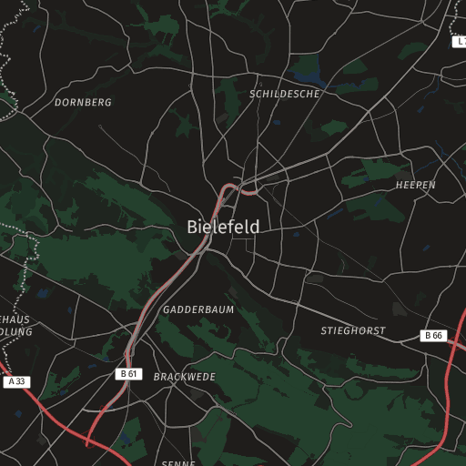</a><br>OSM Americana Dark |
| **Clear**<br><sub>Standard</sub> | <a href="docs/previews/clear.png">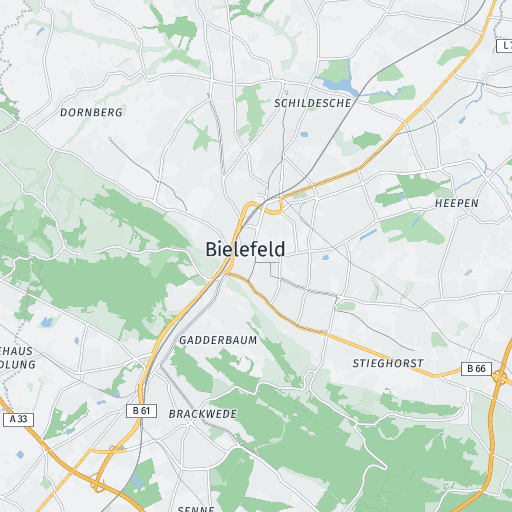</a><br>Clear | <a href="docs/previews/clear-dark.png"></a><br>Clear Dark |
| **Photon**<br><sub>Standard</sub> | <a href="docs/previews/photon.png">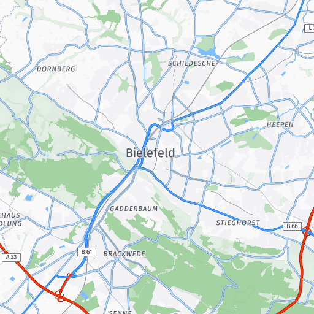</a><br>Photon | <a href="docs/previews/photon-dark.png">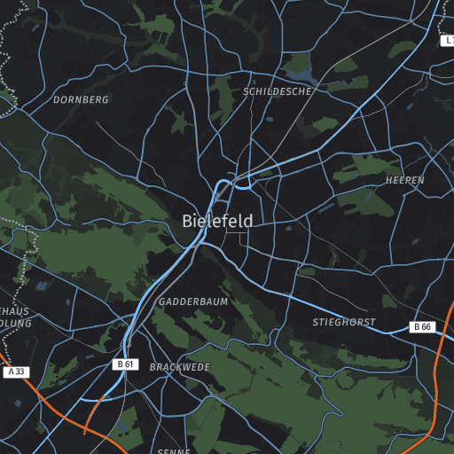</a><br>Photon Dark |
| **Cupertino**<br><sub>Standard</sub> | <a href="docs/previews/cupertino.png"></a><br>Cupertino | <a href="docs/previews/cupertino-dark.png"></a><br>Cupertino Dark |
| **North**<br><sub>Standard</sub> | <a href="docs/previews/north.png">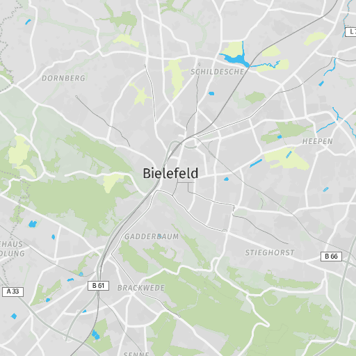</a><br>North | <a href="docs/previews/north-dark.png"></a><br>North Dark |
| **OSM**<br><sub>Standard</sub> | <a href="docs/previews/osm-light.png"></a><br>OSM light | <a href="docs/previews/osm-dark.png"></a><br>OSM dark |
| **Papier**<br><sub>Standard</sub> | <a href="docs/previews/papier.png"></a><br>Papier | <a href="docs/previews/papier-dark.png"></a><br>Papier Dunkel |
| **Protomaps**<br><sub>Standard</sub> | <a href="docs/previews/protomaps-light.png">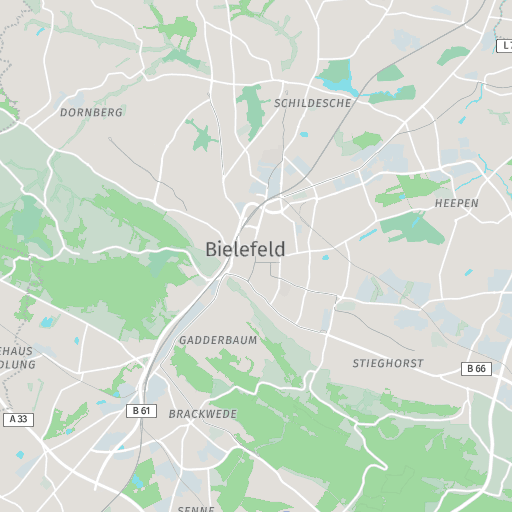</a><br>Protomaps Light | <a href="docs/previews/protomaps-dark.png"></a><br>Protomaps Dark |
| **Wiki**<br><sub>Standard</sub> | <a href="docs/previews/wiki.png"></a><br>Wiki | <a href="docs/previews/wiki-dark.png"></a><br>Wiki Dark |
| **Historisch**<br><sub>Standard</sub> | <a href="docs/previews/historisch.png">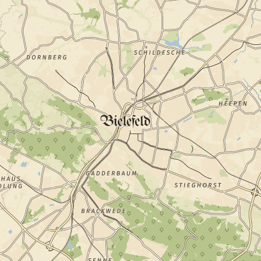</a><br>Historisch | – |
| **Kupferstich**<br><sub>Standard</sub> | <a href="docs/previews/kupferstich.png"></a><br>Kupferstich | – |
| **Catppuccin**<br><sub>Nerd</sub> | <a href="docs/previews/catppuccin-latte.png">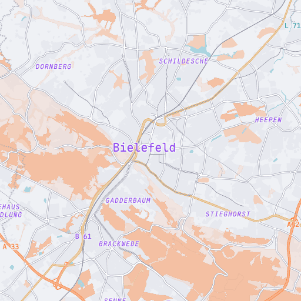</a><br>Catppuccin Latte | <a href="docs/previews/catppuccin-mocha.png">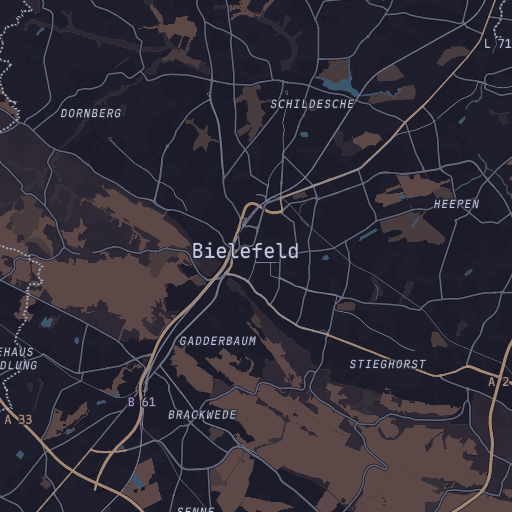</a><br>Catppuccin Mocha |
| **Dracula**<br><sub>Nerd</sub> | <a href="docs/previews/dracula-light.png"></a><br>Alucard | <a href="docs/previews/dracula.png">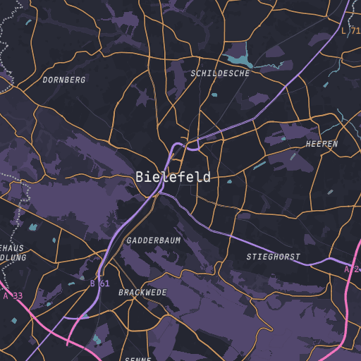</a><br>Dracula |
| **Everforest**<br><sub>Nerd</sub> | <a href="docs/previews/everforest-light.png">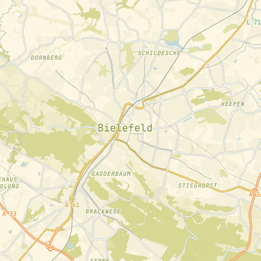</a><br>Everforest Light | <a href="docs/previews/everforest-dark.png"></a><br>Everforest Dark |
| **One**<br><sub>Nerd</sub> | <a href="docs/previews/one-light.png">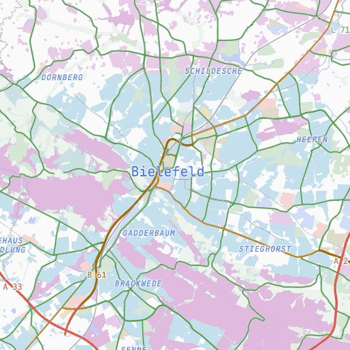</a><br>One Light | <a href="docs/previews/one-dark.png">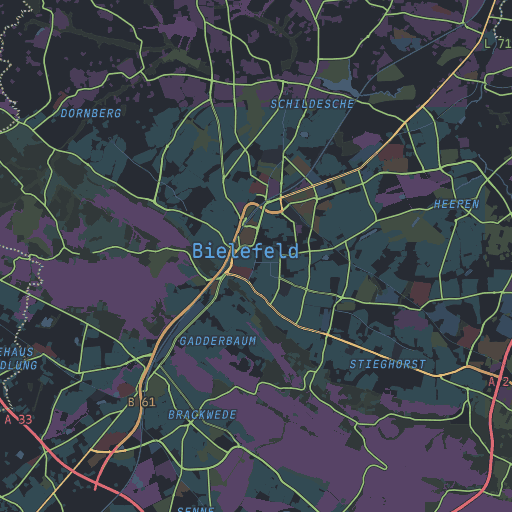</a><br>One Dark |
| **Photon Dev**<br><sub>Nerd</sub> | <a href="docs/previews/photon-dev-light.png"></a><br>Photon Dev Light | <a href="docs/previews/photon-dev-dark.png"></a><br>Photon Dev Dark |
| **Gruvbox**<br><sub>Nerd</sub> | <a href="docs/previews/gruvbox-light.png">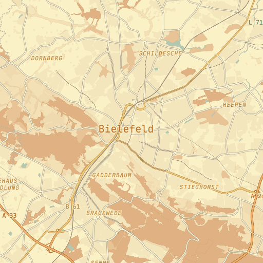</a><br>Gruvbox Light | <a href="docs/previews/gruvbox-dark.png"></a><br>Gruvbox Dark |
| **Nightfox**<br><sub>Nerd</sub> | <a href="docs/previews/dayfox.png">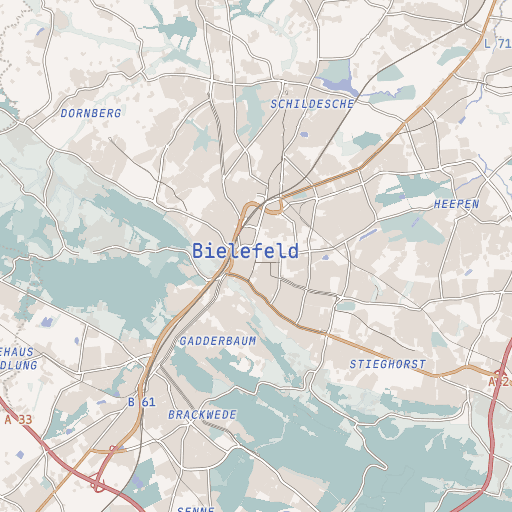</a><br>Dayfox | <a href="docs/previews/nightfox.png"></a><br>Nightfox |
| **Solarized**<br><sub>Nerd</sub> | <a href="docs/previews/solarized-light.png"></a><br>Solarized Light | <a href="docs/previews/solarized-dark.png"></a><br>Solarized Dark |
| **Tokyo Night**<br><sub>Nerd</sub> | <a href="docs/previews/tokyonight-day.png"></a><br>Tokyo Night Day | <a href="docs/previews/tokyonight-night.png"></a><br>Tokyo Night |
| **Bluecron**<br><sub>Nerd</sub> | <a href="docs/previews/bluecron-tag.png"></a><br>Bluecron Tag | <a href="docs/previews/bluecron.png">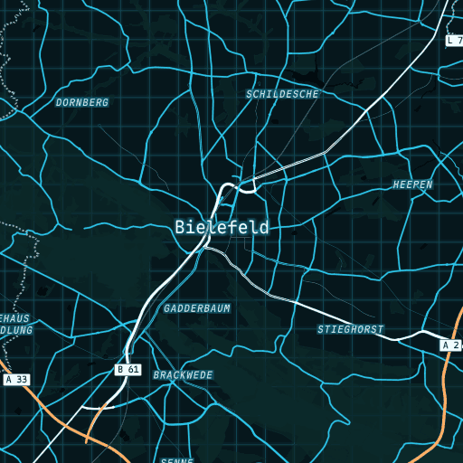</a><br>Bluecron |
| **Phosphor**<br><sub>Nerd</sub> | <a href="docs/previews/bernstein.png"></a><br>Bernstein | <a href="docs/previews/phosphor.png">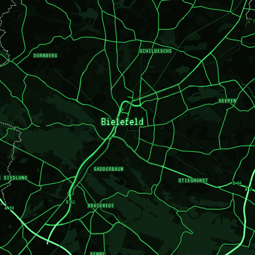</a><br>Phosphor |
| **Neon Cyberpunk**<br><sub>Nerd</sub> | <a href="docs/previews/cyberpunk-day.png"></a><br>Cyberpunk Day | <a href="docs/previews/cyberpunk.png"></a><br>Neon Cyberpunk |

## Einrichtung

```sh
pip install -r requirements.txt     # fontTools
cargo install build_pbf_glyphs      # Rust-Programm, wandelt Schriften in Karten-Glyphen um
```

Außerdem nötig: podman, pngquant und Inkscape (`sudo dnf install pngquant inkscape`). Beim ersten Lauf lädt das Skript die OSM-Daten der Region und die Ersatzschrift Noto Sans und erzeugt die Glyphen. Das dauert einmalig einige Minuten.

## Karte für eine Website

```sh
./make-tiles.py --lat 52.0211 --lon 8.5347 --style styles/clear.toml --font "Public Sans" --retina --out out/kunde-xy
```

| Option | Bedeutung | Standard |
|---|---|---|
| `--lat`, `--lon` | Position des Markers | Bielefeld-Innenstadt |
| `--place` | Ortsname oder Adresse statt `--lat`/`--lon`, z. B. `"Sparrenburg, Bielefeld"`; per Nominatim (OSM) in Koordinaten übersetzt, erster Treffer | – |
| `--style` | Stil-Datei aus `styles/` | `styles/clear.toml` |
| `--font` | Schrift, z. B. `"Inter"`, `"JetBrains Mono"` | `font` im Stil |
| `--radius` | Bereich in km um den Marker | 5 |
| `--zoom` | Zoomstufen | `10-18` |
| `--detail-from`, `--detail-radius` | ab dieser Stufe nur dieser Bereich in km | 17, 1 |
| `--viewport` | größte Kartengröße in px, damit niedrige Zoomstufen sie füllen | `2560x1440` |
| `--retina` | zusätzlich @2x-Kacheln für hochauflösende Bildschirme | aus |
| `--format` | `png` (Palette über pngquant) oder `webp` | `png` |
| `--colors` | Farben je PNG-Kachel | 32 |
| `--pixel [4\|2]` | 8-Bit-Look für jeden Stil (siehe [8-Bit-Modus](#8-bit-modus)), Pixel 4-fach (Schrift Silkscreen) oder 2-fach (VT323) | aus |
| `--streets-only` | nur Straßennetz, Wasser und Ortsnamen (Poster-Look); mit `--all` nach `out/<stil>-<schrift>-streets` | aus |
| `--area` | Geofabrik-Region, muss den Bereich enthalten (https://download.geofabrik.de) | `detmold-regbez` |
| `--label` | Text im Marker (Sprechblase bzw. Terminal `~/<label>`) | `hier` |
| `--out` | Zielordner | `out/<stilname>` |

Nach Änderungen an Stilen die README-Bilder neu erzeugen: `./make-tiles.py --readme-previews` (gut 30 Sekunden).

Nach Änderungen an `template.html`, am Marker oder am Label reicht `./make-tiles.py --reindex [--label …]`: Das schreibt die `index.html` aller Varianten neu, ohne Kacheln zu rendern.

Das Ergebnis in `out/kunde-xy/` (`tiles/`, `leaflet/`, `index.html`) einfach neben die Website hochladen.

## Varianten vergleichen

```sh
./make-tiles.py --all --zoom 16-16 --radius 1.5 --retina             # jeder Stil in seiner Vorschau-Schrift -> out/<stil>-<schrift>
./make-tiles.py --all --all-fonts --missing ...                     # volle Matrix: jeder Stil × alle Schriften seiner Gruppen
./make-tiles.py --all --style styles/wiki.toml ...                  # nur ein Stil
./make-tiles.py --all --font "Inter" ...                            # alle Stile in einer bestimmten Schrift
```

Für die Vorschau nutzt jeder Stil seine `preview_font` (Standard-Stile Fira Sans, Nerd-Stile Maple Mono); 34 Varianten dauern so etwa 4 Minuten. `--missing` überspringt schon gerenderte Varianten.

`out/index.html` ist dieselbe Vorschauseite wie die öffentliche in `site/`: eine durchgehende Karte, senkrecht geteilt in einen Streifen pro Stil, mit Einzelansicht und Vergleich.

Sie hat die Schalter **Standard | Nerd** und **Hell | Dunkel**. Stile derselben Familie sind Gegenstücke: Beim Umschalten wird aus Clear „Clear Dark“, aus Catppuccin Latte „Mocha“. Hat eine Familie einen Modus nicht, bleibt ihr Platz leer und ist beschriftet.

## Öffentliche Vorschau (GitHub Pages)

```sh
./make-tiles.py --site [--missing]     # Einstellungen aus site.toml -> site/
```

`site.toml` legt Ort (Bielefeld, Sparrenburg), Label, Zoom (16), Bereich (1,2 km um die Sparrenburg), Retina (an; mit den 8-Bit-Varianten der Nerd-Stile gut 500 MB, Pages erlaubt 1 GB) und die Schrift je Gruppe fest (Standard: Fira Sans; Nerd: Maple Mono). Ergebnis ist eine statische Seite in `site/` (`index.html` = Streifen-Ansicht) für GitHub Pages; sie wird als eigener Branch `gh-pages` ohne Historie veröffentlicht, nicht in `main`.

Die Streifen-Seite nutzt Tailwind CSS, lokal gebaut (kein CDN): `npm install && npm run css` erzeugt `vendor/streifen.css` aus `src/streifen.css`. Im Querformat sind die Streifen senkrecht, im Hochformat (Handy) waagerecht. Der Dialog „Über“ nennt alle Quellen und Lizenzen.

## Stile

Jeder Stil ist eine kurze Textdatei in `styles/`. Das Skript baut daraus zusammen mit der Grundlage `style/base.json` (OSM Bright) den fertigen Stil.

```toml
title = "North"              # Fenstertitel, die Schrift wird angehängt
category = "standard"        # standard | nerd   (Gruppe in der Vorschau)
mode = "light"               # light | dark
family = "North"             # gleiche Familie = Gegenstück beim Hell/Dunkel-Umschalten
order = 50                   # Reihenfolge in der Streifen-Ansicht (höher = weiter rechts), dann alphabetisch
font = "Overpass"            # Standardschrift
preview_font = "Fira Sans"   # Schrift für die Vorschau (--all)
fonts = ["sans", "serif"]    # Schriftgruppen für --all-fonts (Standard); Nerd-Stile zusätzlich "mono"
text_scale = 1.15            # Faktor für alle Beschriftungen
language = "de"              # Beschriftungssprache (name:de, sonst Originalname); Standard de
attribution = "Stil inspiriert von …"
hide = ["poi_r20"]           # Ebenen ausblenden (poi_r1 = wichtigste Orte, poi_r20 = unwichtigste)

[paint."*-motorway*"]        # Ebenen per Namensmuster, später stehende gewinnen
line-color = "#e892a2"
```

Die Ebenennamen stehen in `style/base.json`. Pro Ebene werden nur passende Eigenschaften gesetzt (`fill-*` auf Flächen, `line-*` auf Linien, `text-*`/`icon-*` auf Beschriftungen), daher sind breite Muster wie `water*` unbedenklich.

| Stil | Gruppe | Schrift | Vorbild |
|---|---|---|---|
| **OSM Americana** / Dark | Standard | Overpass | Stil der OSM-US-Community (openstreetmap-americana, CC0); dunkle Variante eigene Ableitung |
| **Clear** / Clear Dark | Standard | Fira Sans | eigener Stil: kühl und reduziert, Farbe nur für Hauptstraßen (Standard) |
| **Photon** / Dark | Standard | Fira Sans | Mozillas Photon-Farbsystem (MPL-2.0) als normale Karte: neutrale Ortsnamen, Straßenschilder, Blasen-Marker |
| **Cupertino** / Dark | Standard | Public Sans | angelehnt an den Gesamteindruck von Apple Maps (eigene Farbwahl) |
| **North** / Dark | Standard | DINish | Farben nach der Palette von Hydda (BSD-3) |
| **OSM light** / OSM dark | Standard | Atkinson Hyperlegible Next | OSM-Standardkarte (openstreetmap-carto, CC0), aufgehellt und aufgeräumt |
| **Papier** | Standard | Literata | eigener Stil: warmes Cremeweiß, Sepia-Konturen, Olivgrün, wie eine gedruckte Karte; dunkel wie auf dunklem Karton |
| **Historisch** | Standard | TeX Gyre Schola, Ortsnamen UnifrakturMaguntia | eigener Stil: kolorierter Stadtplan um 1900 (rosa Häuser, Wald-/Wiesen-/Friedhofs-Signaturen, Wasserlinien, Bahn als Schwarz-Weiß-Band, stillgelegte Strecken aus OSM wie in Betrieb, Altersflecken in den Kacheln, Papierkorn im Browser); nur hell |
| **Kupferstich** | Standard | IM Fell English, Ortsnamen UnifrakturMaguntia | eigener Stil im Look eines Kupferstichs des 18. Jh.: einfarbig Sepia, sonst wie Historisch; nur hell |
| **Protomaps Light** / **Dark** | Standard | Figtree | Protomaps Basemaps (Design CC0) |
| **Wiki** / Dark | Standard | Work Sans | Wikimedia Maps (github.com/wikimedia/osm-bright.tm2; Design CC BY 3.0, Namensnennung im Stil) |
| **Dayfox** / **Nightfox** | Nerd | Adwaita Mono | Editor-Theme Nightfox (MIT) |
| **Catppuccin Latte** / **Mocha** | Nerd | Fantasque Sans Mono | Catppuccin (MIT) |
| **Alucard** / **Dracula** | Nerd | Fira Code | Dracula, helle Variante nach der offiziellen Alucard-Palette (MIT) |
| **Everforest Light** / **Dark** | Nerd | Ubuntu Sans Mono | Everforest (MIT) |
| **One Light** / **Dark** | Nerd | Hack | Atom One (MIT); Regenbogen: Straßenhierarchie durch die sieben Syntaxfarben |
| **Photon Dev Light** / **Dark** | Nerd | Fira Code | Theme der Mozilla-Entwicklerwerkzeuge (devtools/client/themes/variables.css, Photon-Farben, MPL-2.0): Hauptstraßen highlight-blue, Autobahn Photon-Orange, Beschriftung in der Akzentfarbe |
| **Gruvbox Light** / **Dark** | Nerd | IBM Plex Mono | Gruvbox (MIT) |
| **Solarized Light** / **Dark** | Nerd | Intel One Mono | Solarized (MIT) |
| **Tokyo Night Day** / **Night** | Nerd | JetBrains Mono | tokyonight.nvim (Apache-2.0) |
| **Bluecron Tag** / **Bluecron** | Nerd | Mozilla Text | eigener Entwurf (Arbeitstitel) im Look von Tron: fast schwarzer Grund, Gebäude als Drahtgitter mit Cyan-Kante, Hauptstraßen weißglühend mit Cyan-Leuchtschein, Autobahn Orange; hell als Drahtgitter auf Papier ohne Leuchten. Schrift Mozilla Text |
| **Bernstein** / **Phosphor** | Nerd | VT323 | eigener Entwurf: Röhrenmonitor in Grün (P1-Phosphor) bzw. Bernstein (P3), Scanlines und Vignette, Schrift VT323. Bernstein ist in der Familie die „helle“ Variante, obwohl das Bild dunkel ist. Die Röhren-Effekte sind eine CSS-Ebene im Browser (`overlay` im Stil) und fehlen daher in den Bildern oben |
| **Cyberpunk Day** / **Neon Cyberpunk** | Nerd | Space Mono | maptoposter „neon_cyberpunk“ (MIT); helle Variante eigener Entwurf in Warnfarben: gelber Grund, Pink und Cyan, schwarze Konturen, ohne Leuchten |

Die Schrift ist die der öffentlichen Vorschau (`site_font` im Stil, sonst die Gruppenschrift aus `site.toml`); die 8-Bit-Varianten nutzen dort Silkscreen. Mit `--font` lässt sich jeder Stil in jeder Schrift aus `style/fonts.toml` rendern.

Die Stile sind eigene Umsetzungen: Von den Vorbildern sind nur Farbwerte übernommen, keine Stildateien. Jeder Nachbau nennt sein Vorbild in `attribution`; bei Wiki verlangt die Lizenz das.

Die Standard-Stile haben einen **Blasen-Marker**: das Label in einem abgerundeten Kasten, darunter ein Stiel mit einem Punkt genau auf der Position, damit das Ziel frei bleibt. Bei hellen Stilen weiß, bei dunklen im Grundton, Rahmen, Stiel und Punkt in der Akzentfarbe des Stils (Abschnitt `[marker]`, `type = "bubble"`).

Die Nerd-Stile haben statt des Leaflet-Markers einen **Terminal-Marker**: ein Kästchen `~/<label>` mit Block-Cursor (nicht blinkend) in den Akzentfarben, darunter Stiel und Punkt auf der Position (Abschnitt `[marker]` in der Stil-Datei: `type = "terminal"`, `color`, `color2`, `bg`, `fg`). Der Text nutzt die Monoschrift des Betrachters (`ui-monospace`).

POI-Symbole sind [Phosphor Icons](https://phosphoricons.com/) (MIT) im Kreis: Kreis in einer dezenten Variante der Akzentfarbe des Stils, Symbol in seiner POI-Farbe. Die Strichstärke folgt der Schrift (Mono fett, Serif leicht, sonst normal). Zuordnung in `style/icons.toml`. Motive, die Phosphor fehlen (Riesenrad, Hubschrauber, Obelisk, Rutsche, Vulkan, Elefant, Amphore, Staudamm), sind im Phosphor-Stil nachgezeichnet (`vendor/phosphor-extra/`).

Grünflächen (Parks, Wiesen, Wald) erscheinen in den Nerd-Stilen in der Signaturfarbe des Themes, mit dem Grund gemischt: Tokyo Night Neon-Pink, Dracula/Alucard Lila, Catppuccin Peach, Nightfox/Dayfox Cyan, Solarized Gold (bei Solarized Dark in OKLCH bestimmt, weil die Mischung mit dem blaugrünen Grund sonst Grün ergäbe), Gruvbox Orange. One (Regenbogen) zeigt Wald violett, Wiesen grün und Häuser je nach OSM-ID in einer der sieben Farben. Everforest bleibt grün, weil Grün dort die Signaturfarbe ist.

In den Nerd-Stilen erscheinen Straßennummern (A, B, L, K) ohne weißes Schild, dafür in den Akzentfarben des Themes, je nach Straßenart (Block „Akzent-Beschriftung“ am Ende der Datei).

Die dunklen Standard-Stile sind nicht invertiert (dann würden weiße Straßen dunkler als der Grund), sondern über Kartenrollen abgeleitet: Aus dem Farbton des hellen Grunds entsteht eine dunkle Graustufenleiter mit demselben Charakter (Clear kühl, Wiki warm); Wasser, Grün und Straßenfarben behalten Farbton und Sättigung und werden nur in der Helligkeit angepasst (OKLCH). Die Editor-Themes ordnen ihre Paletten denselben Rollen zu (Grund, Gebäude, Wasser, Grün, drei Straßenstufen, Schrift). Alle Dateien lassen sich von Hand nachjustieren.

## Schriften

Im Git liegen nur die Schriftquellen samt Lizenz (`fonts-src/<schrift>/`). Die Glyphen erzeugt `make-tiles.py` beim ersten Lauf nach `style/fonts/`. Welche Schnitte aus welcher Datei entstehen, steht in `style/fonts.toml`:

```toml
[Literata]
group   = "serif"  # sans | serif | mono
Regular = { file = "literata/Literata-VF.ttf", wght = 400, opsz = 12 }
Bold    = { file = "literata/Literata-VF.ttf", wght = 700, opsz = 12 }
Italic  = { file = "literata/Literata-Italic-VF.ttf", wght = 400, opsz = 12 }
scale   = 1.05     # optional: Größenfaktor
streets = "450"    # optional: eigener Schnitt für Straßennamen (muss oben als Schnitt stehen)
```

Ohne Achsenwerte wird die Datei unverändert übernommen, mit Achsenwerten wird aus der variablen Schrift ein fester Schnitt erzeugt. Neue Schrift: Dateien nach `fonts-src/<schrift>/` legen und eine Tabelle in `fonts.toml` ergänzen. Nach einer Änderung an einem bestehenden Schnitt dessen Ordner in `style/fonts/` löschen, damit er neu erzeugt wird.

| Schrift | Gruppe | Lizenz |
|---|---|---|
| Atkinson Hyperlegible Next, DINish, Figtree, Fira Sans, Inter, Mozilla Text, Overpass, Public Sans, Work Sans | sans | OFL |
| TeX Gyre Heros | sans | GUST Font License |
| Literata, IM Fell English | serif | OFL |
| UnifrakturMaguntia | blackletter (nur Ortsnamen in Historisch/Kupferstich) | OFL |
| TeX Gyre Schola | serif | GUST Font License |
| Adwaita Mono, Fantasque Sans Mono, Fira Code, IBM Plex Mono, Intel One Mono, JetBrains Mono, Maple Mono, Space Mono, Victor Mono | mono (bei `--all-fonts` nur für Nerd-Stile) | OFL |
| Hack | mono (bei `--all-fonts` nur für Nerd-Stile) | MIT + Bitstream-Vera-Lizenz |
| Ubuntu Sans Mono | mono (bei `--all-fonts` nur für Nerd-Stile) | Ubuntu Font Licence 1.0 |
| Press Start 2P, Silkscreen, VT323 | pixel (nur für `--pixel`) | OFL |

Noto Sans ist keine eigene Variante, sondern nur Ersatz für Zeichen, die einer Schrift fehlen (z. B. Kyrillisch).

Mit `--font` lässt sich jede Schrift mit jedem Stil kombinieren, auch eine Monoschrift mit einem Standard-Stil. Die Gruppen und `preview_font` legen nur fest, was `--all` bzw. `--all-fonts` automatisch rendert.

## Bildformat

Standard: PNG mit 32-Farben-Palette über pngquant, danach verlustfrei mit oxipng nachkomprimiert (optional, `cargo install oxipng`; ohne oxipng wird der Schritt übersprungen).

Gemessen an 80 Retina-Kacheln um die Sparrenburg (Zoom 16; Stile Clear, Papier, Protomaps Dark, Dracula, Gruvbox Light):

| Farben | ohne oxipng | mit oxipng | Abweichung vom Original |
|---|---|---|---|
| 16 | 2,99 MB | 2,68 MB | 1,30 % |
| 24 | 3,30 MB | 3,04 MB | 0,88 % |
| **32** (Standard) | 3,62 MB | **3,37 MB** | **0,70 %** |

oxipng kostet auf einer 2-Kern-VM etwa 0,2 s pro Kachel. Unter 16 Farben verlieren Symbole sichtbar Farbe. Zum Vergleich (ältere Messung, Stil Clear): WebP ist etwa so groß wie 32 Farben ohne oxipng, weicht aber mit 0,91 % stärker ab.

Ohne Dithering (`--nofs`), sonst werden die Dateien größer und die Flächen unruhig.

## 8-Bit-Modus

`--pixel` lässt jeden Stil wie 8-Bit-Pixelkunst aussehen: grobe Pixel, 16 flache Farben mit harten Stufen, dunkle Umrisse, Wasser- und Wiesenmuster, Schrift im Pixelraster.

```sh
./make-tiles.py --style styles/dracula.toml --pixel                           # 4-fache Pixel, Schrift Silkscreen
./make-tiles.py --style styles/dracula.toml --pixel 2                         # 2-fache Pixel, Schrift VT323
./make-tiles.py --style styles/dracula.toml --pixel --font "Press Start 2P"   # andere Pixelschrift
```

- **Pixel:** Jede Kachel entsteht aus der Kachel zwei Zoomstufen darüber. Deren passendes Sechzehntel (64×64 px) sind die echten 8-Bit-Pixel, die ohne Glättung auf 256 px vergrößert werden, also 4×4-Blöcke (@2x: 8×8). Mit `--pixel 2` eine Stufe darüber, 128×128 px und 2×2-Blöcke.
- **Farben:** eine Palette mit 16 Farben je Stil, für alle Kacheln gleich. Sie stammt aus den Farben der Stil-Datei: die häufigste, dann die, die sich am stärksten unterscheiden. Jedes Pixel bekommt flach die nächste Palettenfarbe: Leuchtschein und Kanten werden zu harten Stufen, verirrte Einzelpixel verschwinden.
- **Beschriftung:** wird getrennt von der Karte gerendert (eigene kleine Palette mit den Textfarben), in dreifacher Auflösung, je Beschriftung so verschoben, dass die Striche genau ins 8-Bit-Raster fallen, und dann in die Kachel eingebacken. So bleibt Schrift scharf, auch wenn sie dieselbe Farbe wie eine Straße hat.
- **Umrisse und Muster:** Flächen neben deutlich helleren Pixeln bekommen einen dunklen Umriss (wie in Sierra-Spielen), außer direkt an der Schrift. Wasser hat Wellenstriche, Parks ein Punktmuster, beide deckungsgleich über Kachelgrenzen.
- **Schrift:** Ein Schriftpixel ist genau ein 8-Bit-Pixel (`grid` in `fonts.toml`, Silkscreen 8 px, VT323 12,5 px). Bei 4-fachen Pixeln ist jede Beschriftung genau einen Rasterschritt groß und erscheint zwei Zoomstufen früher, weil die Karte zwei Stufen gröber gezeichnet wird. Straßennamen stehen waagerecht, weil schräge Schrift nie ins Raster passt.
- **Anzeige:** Die Kartenseite zeigt hochgezoomte Kacheln ohne Glättung (`image-rendering: pixelated`).
- **Voraussetzung:** numpy und Pillow (`requirements.txt`).

| Schrift | Charakter |
|---|---|
| **Silkscreen** (Standard bei 4-fachen Pixeln) | nur Versalien, sehr klar |
| **VT323** (Standard bei `--pixel 2`) | Terminalschrift (DEC VT320), schmal, gut lesbar |
| Press Start 2P | Arcade-Klassiker, breit und fett, am deutlichsten „8 Bit“ |

Da die Karte gröber gezeichnet wird, zeigt sie weniger Beschriftung und Details; die Symbole sind entsprechend größer.

## Ablauf

1. **Planetiler** (Podman) baut aus dem Geofabrik-Extrakt einmalig `data/<area>.mbtiles` (OpenMapTiles-Schema). Zum Aktualisieren die Datei löschen.
2. **tileserver-gl** (Podman) rendert den Stil; das Skript fragt nur die nötigen Kacheln ab, vier gleichzeitig, reduziert sie mit pngquant auf eine Farbpalette und komprimiert sie mit oxipng nach.
3. Der Container wird danach gestoppt. Das Ergebnis ist rein statisch.

Namensnennung auf der Karte: © OpenStreetMap-Mitwirkende (ODbL), © OpenMapTiles, dazu das `attribution` des Stils.

### Warum OpenMapTiles?

Das Schema legt fest, welche Layer und Felder die Kacheln haben und was bei welchem Zoom wegfällt oder vereinfacht wird (Generalisierung). Planetiler bringt es fertig mit, und der Basis-Stil OSM Bright ist dafür gebaut; alle Stile hier sind nur Farb- und Schrift-Overrides darauf. Der Preis ist die Namensnennung (CC BY 4.0).

Geprüfte Alternativen (Stand 11/2026, aus dem Gedächtnis zusammengefasst):

| | OpenMapTiles | Shortbread (Geofabrik) | Protomaps Basemap |
|---|---|---|---|
| Grundidee | ausführlich, für jeden Stil | schlank, stabil, bewusst einfach | Kartendesign Teil des Schemas |
| Max. Zoom der Daten | 14 | 14 | 15 |
| Steuerung je Zoom | feste Schwellen je `class` + `rank` (1 = wichtig) für POIs/Orte | feste Schwellen je Layer, kaum Rangfolge | jedes Objekt trägt ein berechnetes `min_zoom` |
| POIs | ab ~z12, nach Wichtigkeit gestaffelt | im Wesentlichen erst ab z14 | nach Art und Größe gestaffelt |
| Flächen | klein zusammengefasst, vereinfacht | weniger zusammengefasst | niedrige Zooms aus globalen Landbedeckungsdaten |
| Gebäude | ab z13 | z14 | bis z15 |
| Kachelgröße | am größten | am kleinsten | mittel |
| Lizenz Schema | CC BY 4.0 | CC0 | BSD, Design CC0 |

Ab z14 enthalten alle drei praktisch das volle OSM-Detail; Unterschiede gibt es nur bei z10–13. Ein Wechsel würde `style/base.json` und alle Stile betreffen (Layer-Namen ändern sich) und hier nichts Sichtbares verbessern, nur „© OpenMapTiles“ sparen. `rank` nutzen wir, um unwichtige POIs auszublenden (`poi_r20`).

## Lizenz

Eigener Code und eigene Stile: MIT (siehe `LICENSE`). Schriften, Leaflet, Phosphor Icons, OSM Bright und das Wiki-Design stehen unter ihren eigenen Lizenzen, Details in `LICENSE`.
