# Eigene Styles für Tiles mit Leaflet JS

> Ich mag Map Tiles, ich mag Styles, ich mag Webseiten. 
> Eigene Maptiles mit Leaflet auf der Webseite einbinden. 
> Tiles für den gewünschten Bereich im passenden Stil erstellen, auf der Webseite integrieren. 
> 
> Fertig. 
>
> Ganz ohne eigenen Abschnitt im Datenschutz. 

## Auf einen Blick

**WAS:** Ein Skript, das eine fertige, interaktive Karte (Slippy Map mit Leaflet) für eine Website erzeugt: ein kleiner Ausschnitt um einen Ort, mit Marker, im gewünschten Kartenstil und in der Schrift der Website. Heraus kommt ein Ordner mit statischen Kartenkacheln (PNG mit 32-Farben-Palette, wahlweise WebP), einer HTML-Seite und Leaflet, alles selbst gehostet.

**WARUM:**
- **Datenschutz:** Die Karte liegt komplett auf dem eigenen Server. Keine Anfragen an Google Maps, OpenStreetMap oder andere Kartendienste, also kein Abschnitt in der Datenschutzerklärung nötig.
- **Gestaltung:** Die Karte passt zur Website: 62 fertige Stile (31 Paare hell/dunkel), jede Schrift kombinierbar, eigene Markenfarbe auf Knopfdruck.
- **Einfach:** Keine laufenden Kosten, kein API-Schlüssel, kein Kartenserver. Nur statische Dateien.

**WIE:**
1. Stil, Schrift und Ort wählen.
2. `./make-tiles.py --place "Sparrenburg, Bielefeld" --style styles/clear.toml --font "Public Sans" --retina --out out/kunde-xy`
3. Ordner `out/kunde-xy/` auf den Webserver kopieren. Fertig.

Unentschlossen? Alle Stile nebeneinander: **[Live-Vorschau](https://elbym.github.io/custom-osm-tiles/)** oder lokal mit [Varianten vergleichen](#varianten-vergleichen).

---

## Inhalt

1. [Vorschau aller Stile](#vorschau)
2. [Begriffe](#begriffe)
3. [Einrichtung](#einrichtung)
4. [Karte für eine Website](#karte-für-eine-website)
5. [Häufige Aufgaben](#häufige-aufgaben)
6. [Varianten vergleichen](#varianten-vergleichen)
7. [Öffentliche Vorschau (GitHub Pages)](#öffentliche-vorschau-github-pages)
8. [Stile](#stile)
9. [Schriften](#schriften)
10. [Bildformat](#bildformat)
11. [8-Bit-Modus](#8-bit-modus)
12. [Wie es technisch funktioniert](#wie-es-technisch-funktioniert)
13. [Lizenz](#lizenz)

## Vorschau

Alle Stile in ihrer Vorschau-Schrift (Standard: Fira Sans, Nerd: Maple Mono), Bielefeld auf Zoom 12. Erzeugt mit `./make-tiles.py --readme-previews` (je Stil ein 512×512-Bild ohne Marker nach `docs/previews/`).

| | Hell | Dunkel |
|---|---|---|
| **Americana**<br><sub>Standard</sub> | <a href="docs/previews/americana.png">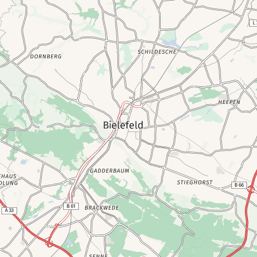</a><br>OSM Americana | <a href="docs/previews/americana-dark.png"></a><br>OSM Americana Dark |
| **Clear**<br><sub>Standard</sub> | <a href="docs/previews/clear.png"></a><br>Clear | <a href="docs/previews/clear-dark.png">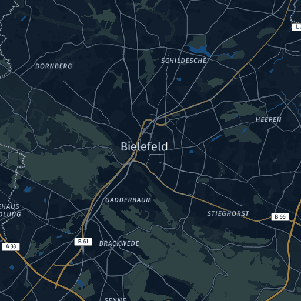</a><br>Clear Dark |
| **Photon**<br><sub>Standard</sub> | <a href="docs/previews/photon.png"></a><br>Photon | <a href="docs/previews/photon-dark.png"></a><br>Photon Dark |
| **Cupertino**<br><sub>Standard</sub> | <a href="docs/previews/cupertino.png"></a><br>Cupertino | <a href="docs/previews/cupertino-dark.png"></a><br>Cupertino Dark |
| **North**<br><sub>Standard</sub> | <a href="docs/previews/north.png"></a><br>North | <a href="docs/previews/north-dark.png"></a><br>North Dark |
| **OSM**<br><sub>Standard</sub> | <a href="docs/previews/osm-light.png">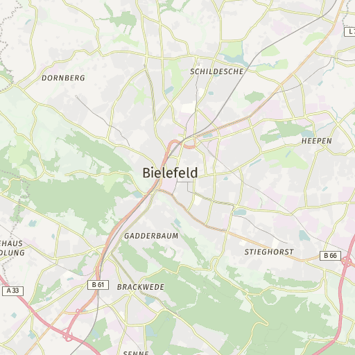</a><br>OSM light | <a href="docs/previews/osm-dark.png">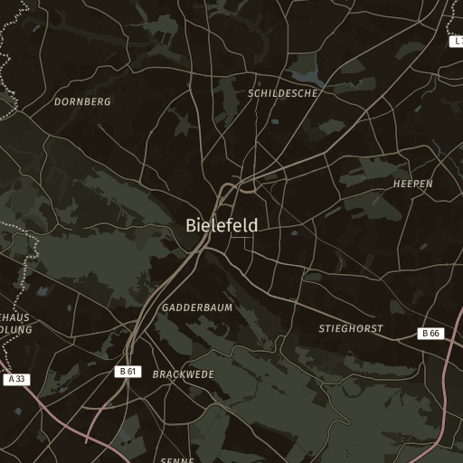</a><br>OSM dark |
| **Papier**<br><sub>Standard</sub> | <a href="docs/previews/papier.png">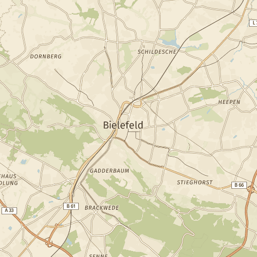</a><br>Papier | <a href="docs/previews/papier-dark.png">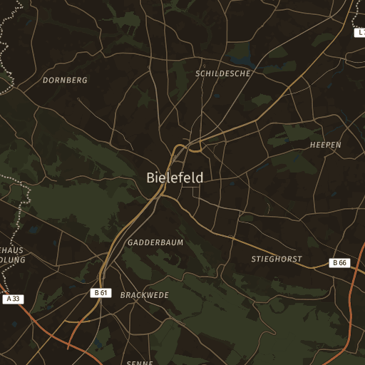</a><br>Papier Dunkel |
| **Protomaps**<br><sub>Standard</sub> | <a href="docs/previews/protomaps-light.png"></a><br>Protomaps Light | <a href="docs/previews/protomaps-dark.png">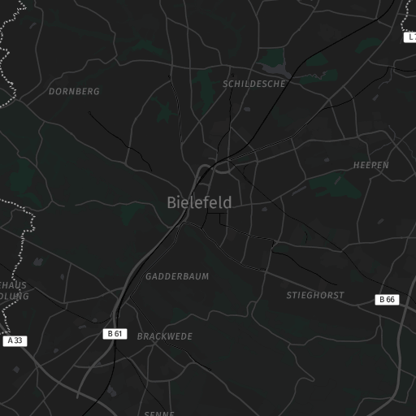</a><br>Protomaps Dark |
| **Wiki**<br><sub>Standard</sub> | <a href="docs/previews/wiki.png"></a><br>Wiki | <a href="docs/previews/wiki-dark.png"></a><br>Wiki Dark |
| **Historisch**<br><sub>Standard</sub> | <a href="docs/previews/historisch.png"></a><br>Historisch | <a href="docs/previews/gaslicht.png">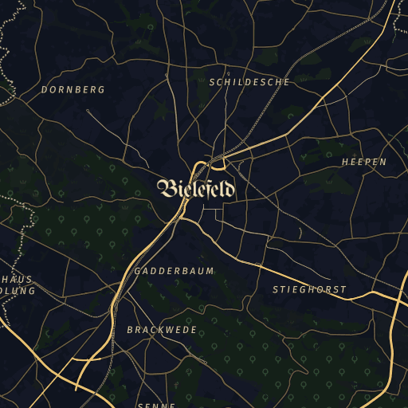</a><br>Gaslicht |
| **Kupferstich**<br><sub>Standard</sub> | <a href="docs/previews/kupferstich.png">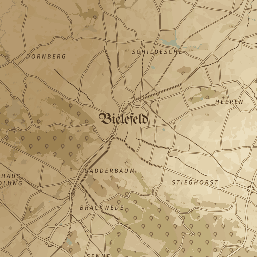</a><br>Kupferstich | <a href="docs/previews/kupferplatte.png">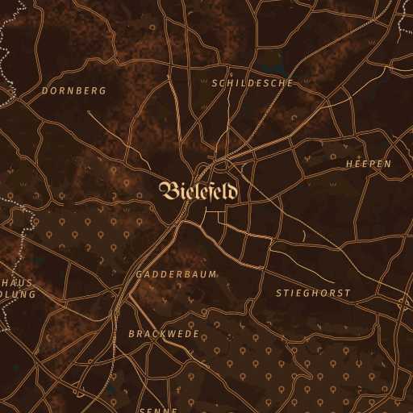</a><br>Kupferplatte |
| **Anime**<br><sub>Standard</sub> | <a href="docs/previews/anime.png">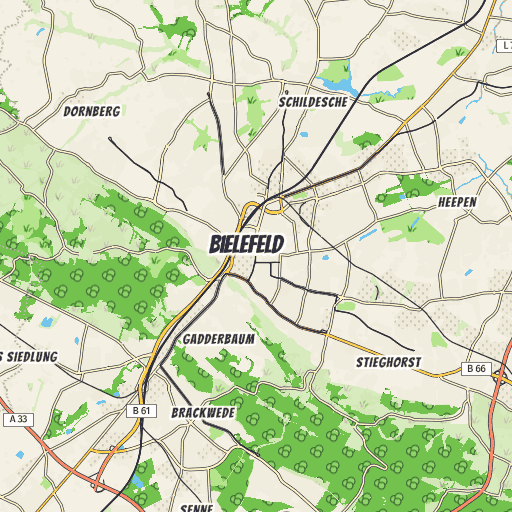</a><br>Anime | <a href="docs/previews/anime-nacht.png">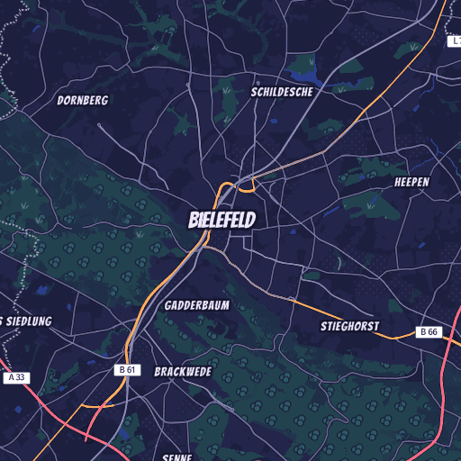</a><br>Anime Nacht |
| **Island**<br><sub>Standard</sub> | <a href="docs/previews/island.png">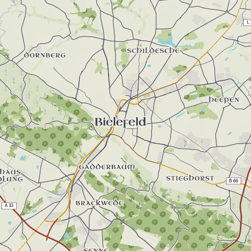</a><br>Island | <a href="docs/previews/nordlicht.png">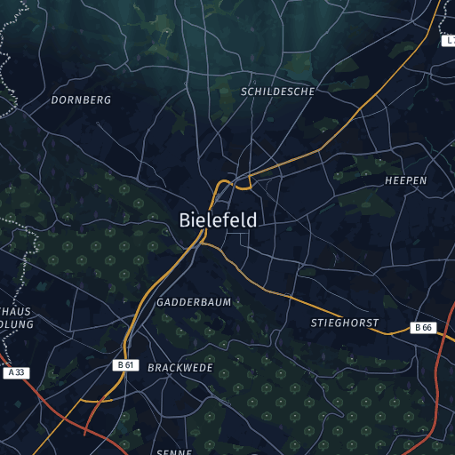</a><br>Nordlicht |
| **Stadtlichter**<br><sub>Standard</sub> | <a href="docs/previews/sonnenaufgang.png">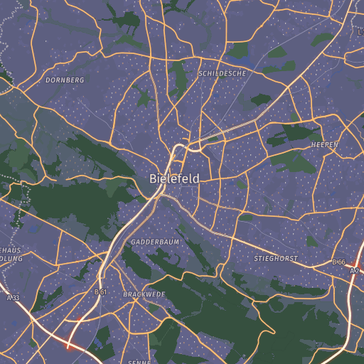</a><br>Sonnenaufgang | <a href="docs/previews/stadtlichter.png">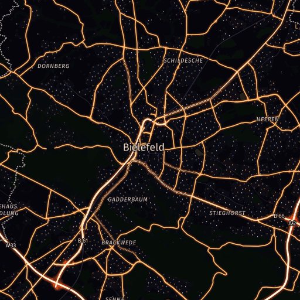</a><br>Stadtlichter |
| **Schwarzplan**<br><sub>Standard</sub> | <a href="docs/previews/schwarzplan.png">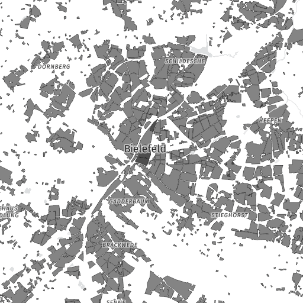</a><br>Schwarzplan | <a href="docs/previews/schwarzplan-dark.png">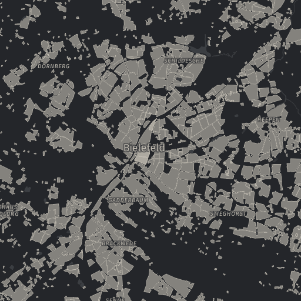</a><br>Weißplan |
| **Blaupause**<br><sub>Standard</sub> | <a href="docs/previews/lichtpause.png">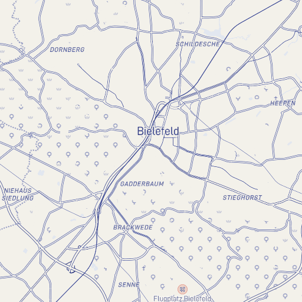</a><br>Lichtpause | <a href="docs/previews/blaupause.png">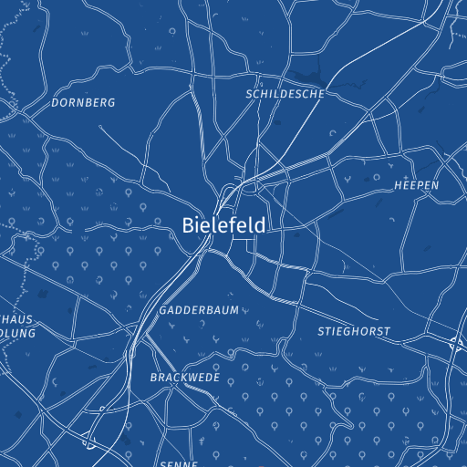</a><br>Blaupause |
| **CMYK**<br><sub>Standard</sub> | <a href="docs/previews/cmyk.png">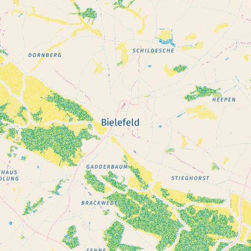</a><br>CMYK | <a href="docs/previews/cmyk-nacht.png">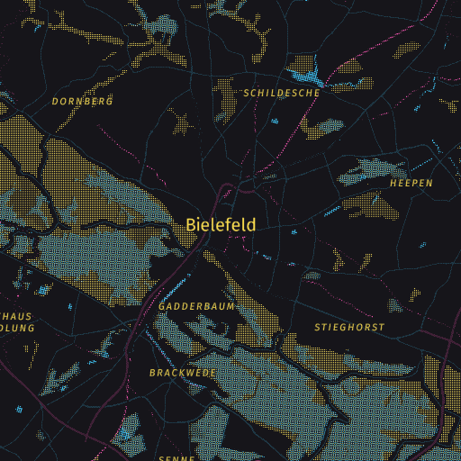</a><br>CMYK Nacht |
| **Aquarell**<br><sub>Standard</sub> | <a href="docs/previews/aquarell.png">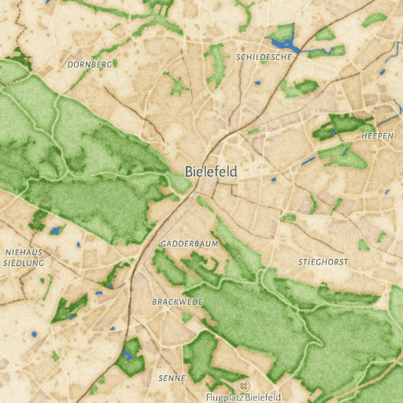</a><br>Aquarell | <a href="docs/previews/aquarell-nacht.png">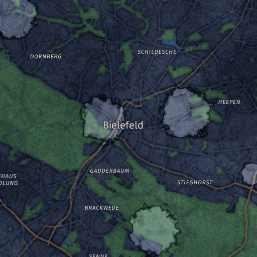</a><br>Aquarell Nacht |
| **Marke**<br><sub>Standard</sub> | <a href="docs/previews/marke.png">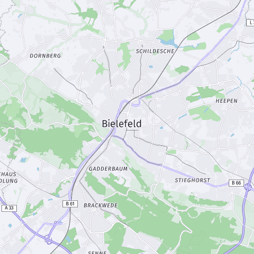</a><br>Marke | <a href="docs/previews/marke-dark.png">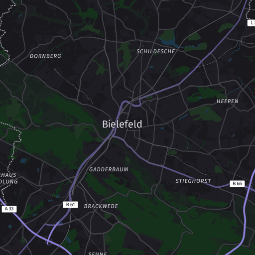</a><br>Marke Dunkel |
| **Catppuccin**<br><sub>Nerd</sub> | <a href="docs/previews/catppuccin-latte.png"></a><br>Catppuccin Latte | <a href="docs/previews/catppuccin-mocha.png"></a><br>Catppuccin Mocha |
| **Dracula**<br><sub>Nerd</sub> | <a href="docs/previews/dracula-light.png"></a><br>Alucard | <a href="docs/previews/dracula.png"></a><br>Dracula |
| **Everforest**<br><sub>Nerd</sub> | <a href="docs/previews/everforest-light.png"></a><br>Everforest Light | <a href="docs/previews/everforest-dark.png">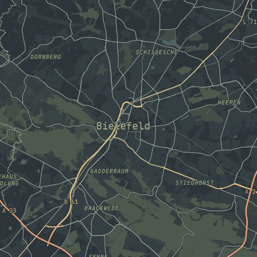</a><br>Everforest Dark |
| **One**<br><sub>Nerd</sub> | <a href="docs/previews/one-light.png"></a><br>One Light | <a href="docs/previews/one-dark.png"></a><br>One Dark |
| **Photon Dev**<br><sub>Nerd</sub> | <a href="docs/previews/photon-dev-light.png">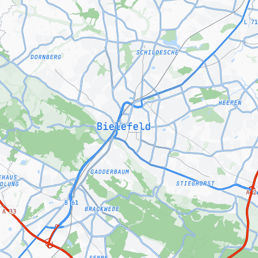</a><br>Photon Dev Light | <a href="docs/previews/photon-dev-dark.png">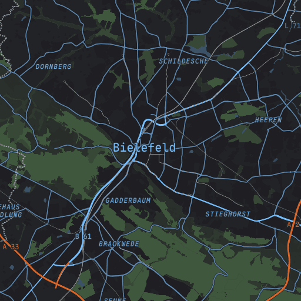</a><br>Photon Dev Dark |
| **Gruvbox**<br><sub>Nerd</sub> | <a href="docs/previews/gruvbox-light.png"></a><br>Gruvbox Light | <a href="docs/previews/gruvbox-dark.png">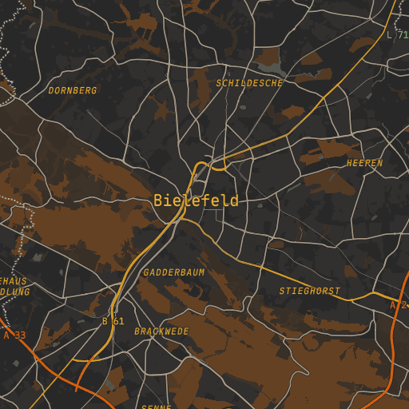</a><br>Gruvbox Dark |
| **Nightfox**<br><sub>Nerd</sub> | <a href="docs/previews/dayfox.png"></a><br>Dayfox | <a href="docs/previews/nightfox.png">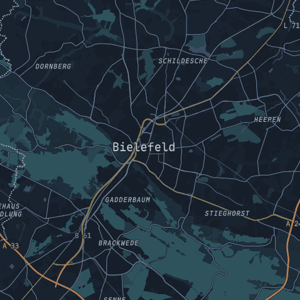</a><br>Nightfox |
| **Solarized**<br><sub>Nerd</sub> | <a href="docs/previews/solarized-light.png">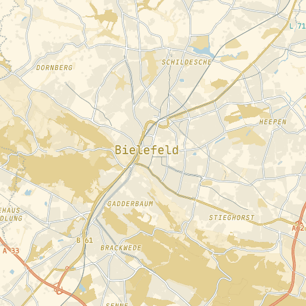</a><br>Solarized Light | <a href="docs/previews/solarized-dark.png">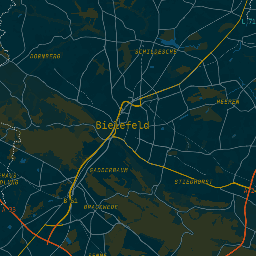</a><br>Solarized Dark |
| **Tokyo Night**<br><sub>Nerd</sub> | <a href="docs/previews/tokyonight-day.png"></a><br>Tokyo Night Day | <a href="docs/previews/tokyonight-night.png"></a><br>Tokyo Night |
| **Bluecron**<br><sub>Nerd</sub> | <a href="docs/previews/bluecron-tag.png">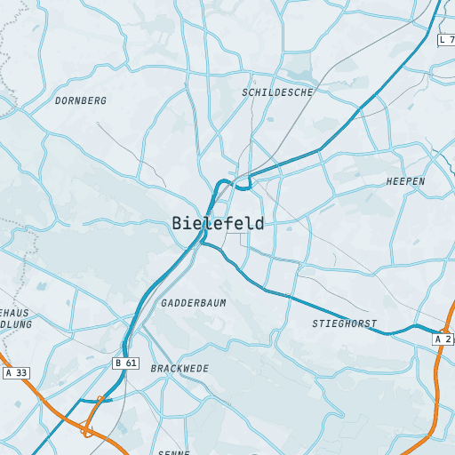</a><br>Bluecron Tag | <a href="docs/previews/bluecron.png"></a><br>Bluecron |
| **Phosphor**<br><sub>Nerd</sub> | <a href="docs/previews/bernstein.png">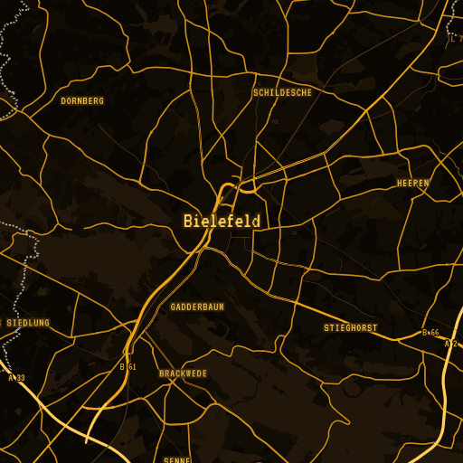</a><br>Bernstein | <a href="docs/previews/phosphor.png"></a><br>Phosphor |
| **Neon Cyberpunk**<br><sub>Nerd</sub> | <a href="docs/previews/cyberpunk-day.png">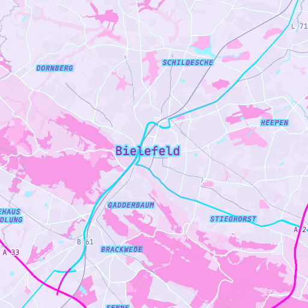</a><br>Cyberpunk Day | <a href="docs/previews/cyberpunk.png">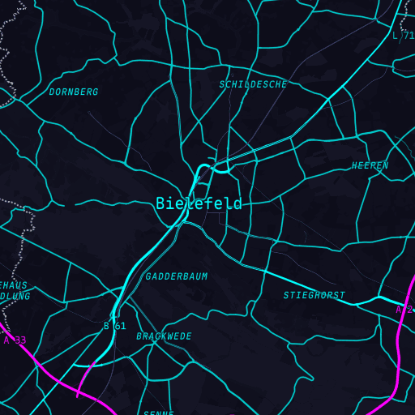</a><br>Neon Cyberpunk |
| **Glitch**<br><sub>Nerd</sub> | <a href="docs/previews/datamosh.png">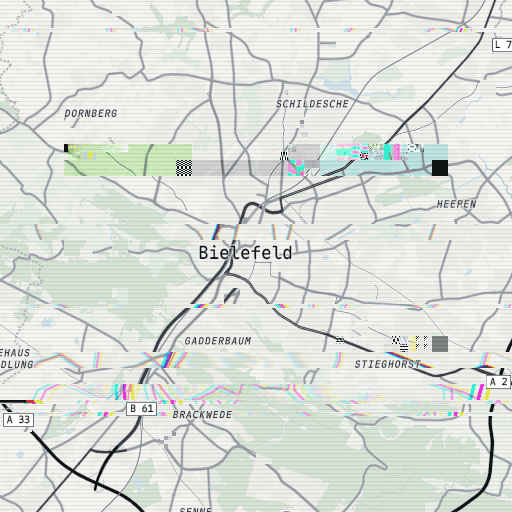</a><br>Datamosh | <a href="docs/previews/signalverlust.png">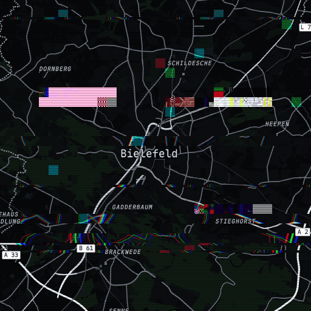</a><br>Signalverlust |

## Begriffe

| Begriff | Bedeutung |
|---|---|
| **Kachel** (Tile) | ein 256×256-Bild eines Kartenausschnitts; Leaflet setzt die Karte daraus zusammen |
| **Zoomstufe** | 10 = Region, 14 = Stadtteil, 18 = Hausnummern; jede Stufe hat viermal so viele Kacheln wie die vorige |
| **Stil** | eine Datei in `styles/`, legt Farben, Schrift und Marker fest |
| **Familie** | zwei Stile, die zusammengehören: eine helle und eine dunkle Fassung (z. B. Clear / Clear Dark) |
| **Gruppe** | **Standard** (normale Karten) oder **Nerd** (Farben von Editor-Themes, Monoschrift, Terminal-Marker) |
| **Variante** | ein gerenderter Stil in einer bestimmten Schrift, Ordner `out/<stil>-<schrift>` |
| **Retina / @2x** | zusätzliche Kacheln in doppelter Auflösung für scharfe Darstellung auf Handys |

## Einrichtung

```sh
pip install -r requirements.txt     # fontTools; für den 8-Bit-Modus numpy, Pillow, scipy
cargo install build_pbf_glyphs      # Rust-Programm, wandelt Schriften in Karten-Glyphen um
cargo install oxipng                # optional, komprimiert die PNGs verlustfrei nach
sudo dnf install pngquant inkscape  # außerdem nötig: podman
```

Beim ersten Lauf lädt das Skript die OSM-Daten der Region und die Ersatzschrift Noto Sans und erzeugt die Glyphen. Das dauert einmalig einige Minuten.

## Karte für eine Website

```sh
./make-tiles.py --lat 52.0211 --lon 8.5347 --style styles/clear.toml --font "Public Sans" --retina --out out/kunde-xy
```

Das Ergebnis in `out/kunde-xy/` (`tiles/`, `leaflet/`, `index.html`) einfach neben die Website hochladen.

### Optionen

**Ort**

| Option | Bedeutung | Standard |
|---|---|---|
| `--lat`, `--lon` | Position des Markers | Bielefeld-Innenstadt |
| `--place` | Ortsname oder Adresse statt `--lat`/`--lon`, z. B. `"Sparrenburg, Bielefeld"`; per Nominatim (OSM) in Koordinaten übersetzt, erster Treffer | – |
| `--area` | Geofabrik-Region, muss den Bereich enthalten (https://download.geofabrik.de) | `detmold-regbez` |

**Ausschnitt**

| Option | Bedeutung | Standard |
|---|---|---|
| `--radius` | Bereich in km um den Marker (so weit lässt sich die Karte verschieben) | 5 |
| `--zoom` | Zoomstufen | `10-18` |
| `--detail-from`, `--detail-radius` | ab dieser Stufe nur dieser Bereich in km (spart Dateien) | 17, 1 |
| `--viewport` | größte Kartengröße in px, damit niedrige Zoomstufen sie füllen | `2560x1440` |

**Aussehen**

| Option | Bedeutung | Standard |
|---|---|---|
| `--style` | Stil-Datei aus `styles/` | `styles/clear.toml` |
| `--font` | Schrift, z. B. `"Inter"`, `"JetBrains Mono"` (Liste in `style/fonts.toml`) | `font` im Stil |
| `--label` | Text im Marker (Sprechblase bzw. Terminal `~/<label>`) | `hier` |
| `--retina` | zusätzlich @2x-Kacheln für hochauflösende Bildschirme (etwa 4× so viel Speicher) | aus |
| `--pixel [4\|2]` | 8-Bit-Look für jeden Stil (siehe [8-Bit-Modus](#8-bit-modus)), Pixel 4-fach (Schrift Silkscreen) oder 2-fach (VT323) | aus |
| `--streets-only` | nur Straßennetz, Wasser und Ortsnamen (Poster-Look); mit `--all` nach `out/<stil>-<schrift>-streets` | aus |

**Dateien**

| Option | Bedeutung | Standard |
|---|---|---|
| `--out` | Zielordner | `out/<stilname>` |
| `--format` | `png` (Palette über pngquant) oder `webp` | `png` |
| `--colors` | Farben je PNG-Kachel | `colors` im Stil, sonst 32 |

**Vergleichen und Wartung**

| Option | Bedeutung |
|---|---|
| `--all` | alle Stile rendern, je nach `out/<stil>-<schrift>`; Vergleichsseite `out/index.html` |
| `--all-fonts` | mit `--all`: jeden Stil in allen Schriften seiner Gruppen (dauert lange) |
| `--missing` | mit `--all` oder `--site`: schon gerenderte Varianten überspringen |
| `--regenerate` | mit `--all` oder `--site`: gerenderte Stile nummeriert auflisten, ausgewählte löschen und neu bauen; mit `--missing` zusätzlich die fehlenden |
| `--force` | auch unveränderte Varianten neu rendern (nötig nach Änderungen am Python-Code) |
| `--reindex` | nur die `index.html` aller Varianten neu schreiben, ohne Kacheln zu rendern |
| `--site` | öffentliche Vorschau nach `site/` bauen (Einstellungen in `site.toml`) |
| `--readme-previews` | Vorschaubilder für diese README erzeugen |

## Häufige Aufgaben

| Aufgabe | Befehl |
|---|---|
| Karte für einen Kunden | `./make-tiles.py --place "…" --style styles/<stil>.toml --font "…" --retina --out out/kunde-xy` |
| Stil aus einer Markenfarbe | `tools/gen_marke.py "#rrggbb" name`, dann `--style styles/name.toml` |
| Alle Stile vergleichen | `./make-tiles.py --all --zoom 16-16 --radius 1.5 --retina`, dann `out/index.html` öffnen |
| Nach Änderung an `template.html`, Marker oder Label | `./make-tiles.py --reindex [--label …]` (schreibt die `index.html` aller Varianten neu, ohne Kacheln zu rendern) |
| Nach Änderungen an Stilen: README-Bilder | `./make-tiles.py --readme-previews` (gut 30 Sekunden) |
| Nach Änderungen am Python-Code | `--force` anhängen, sonst werden unveränderte Varianten übersprungen |
| Einzelne Stile neu bauen | `./make-tiles.py --site --regenerate --missing` (auch mit `--all`) |
| Öffentliche Vorschau bauen und veröffentlichen | `tools/deploy-site.sh [--no-build]` |
| OSM-Daten aktualisieren | `data/<area>.mbtiles` löschen, beim nächsten Lauf wird sie neu gebaut |
| Anime-Figuren neu zeichnen | `tools/gen_figures.py` |

## Varianten vergleichen

```sh
./make-tiles.py --all --zoom 16-16 --radius 1.5 --retina             # jeder Stil in seiner Vorschau-Schrift -> out/<stil>-<schrift>
./make-tiles.py --all --all-fonts --missing ...                     # volle Matrix: jeder Stil × alle Schriften seiner Gruppen
./make-tiles.py --all --style styles/wiki.toml ...                  # nur ein Stil
./make-tiles.py --all --font "Inter" ...                            # alle Stile in einer bestimmten Schrift
```

- **Schrift:** Für die Vorschau nutzt jeder Stil seine `preview_font` (Standard-Stile Fira Sans, Nerd-Stile Maple Mono). 34 Varianten dauerten so etwa 4 Minuten.
- **Überspringen:** `--missing` überspringt schon gerenderte Varianten. Unveränderte Varianten (gleicher Stil, gleiche Einstellungen, gleiche OSM-Daten) werden ohnehin übersprungen; `--force` rendert sie trotzdem neu, etwa nach Änderungen am Python-Code.
- **Vergleichsseite:** `out/index.html` ist dieselbe Seite wie die öffentliche in `site/`: eine durchgehende Karte, senkrecht geteilt in einen Streifen pro Stil, mit Einzelansicht und Vergleich.
- **Schalter:** **Standard | Nerd** und **Hell | Dunkel**. Stile derselben Familie sind Gegenstücke: Beim Umschalten wird aus Clear „Clear Dark“, aus Catppuccin Latte „Mocha“. Hat eine Familie einen Modus nicht, bleibt ihr Platz leer und ist beschriftet.

## Öffentliche Vorschau (GitHub Pages)

Live: **https://elbym.github.io/custom-osm-tiles/**

```sh
./make-tiles.py --site [--missing]     # Einstellungen aus site.toml -> site/
tools/deploy-site.sh [--no-build]      # baut mit --site --missing und veröffentlicht site/ als Branch gh-pages
```

`site.toml` legt fest:

| Einstellung | Wert |
|---|---|
| Ort und Label | Bielefeld, SchücoArena |
| Zoom | 15–16 |
| Bereich | 1,5 km um die SchücoArena |
| Retina | an (GitHub Pages erlaubt 1 GB) |
| `exclude` | Familien, die nur in der README-Galerie stehen |
| `pixel` | Familien mit 8-Bit-Variante: Phosphor, Neon Cyberpunk |
| Schrift je Gruppe | Standard: Fira Sans; Nerd: Maple Mono |

- **Ergebnis:** eine statische Seite in `site/` (`index.html` = Streifen-Ansicht). Sie wird als eigener Branch `gh-pages` ohne Historie veröffentlicht, nicht in `main`.
- **CSS:** Die Streifen-Seite nutzt Tailwind CSS, lokal gebaut (kein CDN): `npm install && npm run css` erzeugt `vendor/streifen.css` aus `src/streifen.css`.
- **Layout:** Im Querformat sind die Streifen senkrecht, im Hochformat (Handy) waagerecht.
- **Quellen:** Der Dialog „Über“ nennt alle Quellen und Lizenzen.
- **Tastatur:** <kbd>←</kbd> <kbd>→</kbd> (oder <kbd>J</kbd> <kbd>Ö</kbd>) Stil wechseln, <kbd>↑</kbd> <kbd>↓</kbd> (oder <kbd>L</kbd> <kbd>K</kbd>, <kbd>I</kbd>) Hell/Dunkel, <kbd>N</kbd> Standard/Nerd, <kbd>1</kbd>–<kbd>9</kbd> Stil Nr. n, <kbd>Esc</kbd>/<kbd>A</kbd> alle Stile, <kbd>V</kbd> Vergleich, <kbd>X</kbd> Seiten tauschen, <kbd>T</kbd> Teilung, <kbd>B</kbd> 8 Bit, <kbd>0</kbd> zurück zum Marker, <kbd>+</kbd> <kbd>−</kbd> zoomen, <kbd>H</kbd>/<kbd>?</kbd> Hilfe („Über“).

## Stile

### Übersicht: Standard

| Stil (hell / dunkel) | Schrift | Renderzeit | Vorbild / Idee |
|---|---|---|---|
| **OSM Americana** / Dark | Overpass | 🟢 easy | Stil der OSM-US-Community (openstreetmap-americana, CC0); dunkle Variante eigene Ableitung |
| **Clear** / Clear Dark | Fira Sans | 🟢 easy | eigener Stil: kühl und reduziert, Farbe nur für Hauptstraßen (Standard) |
| **Photon** / Dark | Fira Sans | 🟢 easy | Mozillas Photon-Farbsystem (MPL-2.0) als normale Karte: neutrale Ortsnamen, Straßenschilder, Blasen-Marker |
| **Cupertino** / Dark | Public Sans | 🟢 easy | angelehnt an den Gesamteindruck von Apple Maps (eigene Farbwahl) |
| **North** / Dark | DINish | 🟢 easy | Farben nach der Palette von Hydda (BSD-3) |
| **OSM light** / OSM dark | Atkinson Hyperlegible Next | 🟢 easy | OSM-Standardkarte (openstreetmap-carto, CC0), aufgehellt und aufgeräumt |
| **Papier** / Papier Dunkel | Literata | 🟢 easy | eigener Stil: gedruckte Karte → [Details](#papier) |
| **Historisch** / **Gaslicht** | TeX Gyre Schola, Ortsnamen UnifrakturMaguntia | 🟠 heavy / 🟢 easy | eigener Stil: kolorierter Stadtplan um 1900 → [Details](#historisch--gaslicht) |
| **Kupferstich** / **Kupferplatte** | IM Fell English, Ortsnamen UnifrakturMaguntia | 🟠 heavy | eigener Stil: Kupferstich des 18. Jh. → [Details](#kupferstich--kupferplatte) |
| **Anime** / Nacht | Kalam, Orts- und POI-Namen Bangers | 🟢 easy | eigener Stil im Look von Anime-Zeichentrick → [Details](#anime--anime-nacht) |
| **Island** / **Nordlicht** | Public Sans | 🟢 easy / 🟠 heavy | eigener Stil: isländische Sommerlandschaft → [Details](#island--nordlicht) |
| **Sonnenaufgang** / **Stadtlichter** | Fira Sans | 🟠 heavy | eigener Stil: Stadt von oben bei Sonnenaufgang bzw. Nacht → [Details](#stadtlichter--sonnenaufgang) |
| **Schwarzplan** / **Weißplan** | TeX Gyre Heros | 🟢 easy | eigener Stil: Figur-Grund-Plan → [Details](#schwarzplan--weißplan) |
| **Lichtpause** / **Blaupause** | DINish | 🟢 easy | eigener Stil: technische Zeichnung → [Details](#blaupause--lichtpause) |
| **CMYK** / Nacht | Fira Sans | 🔴 dangerzone | eigener Stil: Plakat im Vierfarb-Druckraster → [Details](#cmyk--cmyk-nacht) |
| **Aquarell** / Nacht | Caveat | 🔴 dangerzone | eigener Stil: lavierte Federzeichnung → [Details](#aquarell--aquarell-nacht) |
| **Marke** / Dunkel | Figtree | 🟢 easy | aus einer Kundenfarbe erzeugt → [Details](#marke--marke-dunkel) |
| **Protomaps Light** / **Dark** | Figtree | 🟢 easy | Protomaps Basemaps (Design CC0) |
| **Wiki** / Dark | Work Sans | 🟢 easy | Wikimedia Maps (github.com/wikimedia/osm-bright.tm2; Design CC BY 3.0, Namensnennung im Stil) |

### Übersicht: Nerd

| Stil (hell / dunkel) | Schrift | Renderzeit | Vorbild / Idee |
|---|---|---|---|
| **Dayfox** / **Nightfox** | Adwaita Mono | 🟢 easy | Editor-Theme Nightfox (MIT) |
| **Catppuccin Latte** / **Mocha** | Fantasque Sans Mono | 🟢 easy | Catppuccin (MIT) |
| **Alucard** / **Dracula** | Fira Code | 🟢 easy | Dracula, helle Variante nach der offiziellen Alucard-Palette (MIT) |
| **Everforest Light** / **Dark** | Ubuntu Sans Mono | 🟢 easy | Everforest (MIT) |
| **One Light** / **Dark** | Hack | 🟢 easy | Atom One (MIT); Regenbogen: Straßenhierarchie durch die sieben Syntaxfarben |
| **Photon Dev Light** / **Dark** | Fira Code | 🟢 easy | Theme der Mozilla-Entwicklerwerkzeuge (devtools/client/themes/variables.css, Photon-Farben, MPL-2.0): Hauptstraßen highlight-blue, Autobahn Photon-Orange, Beschriftung in der Akzentfarbe |
| **Gruvbox Light** / **Dark** | IBM Plex Mono | 🟢 easy | Gruvbox (MIT) |
| **Solarized Light** / **Dark** | Intel One Mono | 🟢 easy | Solarized (MIT) |
| **Tokyo Night Day** / **Night** | JetBrains Mono | 🟢 easy | tokyonight.nvim (Apache-2.0) |
| **Bluecron Tag** / **Bluecron** | Mozilla Text | 🟢 easy | eigener Entwurf im Look von Tron Legacy → [Details](#bluecron-tag--bluecron) |
| **Bernstein** / **Phosphor** | VT323 | 🟢 easy | eigener Entwurf: Röhrenmonitor → [Details](#bernstein--phosphor) |
| **Cyberpunk Day** / **Neon Cyberpunk** | Space Mono | 🟢 easy | maptoposter „neon_cyberpunk“ (MIT) → [Details](#cyberpunk-day--neon-cyberpunk) |
| **Datamosh** / **Signalverlust** | Fira Code | 🔴 dangerzone | eigener Entwurf: kaputte Bilddaten → [Details](#datamosh--signalverlust) |

**Renderzeit** (gemessen auf einem 8-Kern-Rechner: 154 Retina-Kacheln auf Zoom 16 um die Bielefelder Innenstadt, je Stil ein Lauf. Gemessen sind die in der Tabelle genannten Stile; die übrigen sind nach ihren Effekten eingeordnet, z. B. Sonnenaufgang wie Stadtlichter. Bei zwei Angaben gilt die erste für hell, die zweite für dunkel):

| Stufe | Zeit | Faktor | Warum |
|---|---|---|---|
| 🟢 easy | 8–15 s | 1× | nur Farben, Muster und Figuren; rendert der Kartenserver allein (gemessen: Clear 12 s, Schwarzplan 8 s, Anime 14 s, Island 13 s, Gaslicht 14 s) |
| 🟠 heavy | 19–41 s | 1,5–3,5× | Stadtlichter/Sonnenaufgang: viele weichgezeichnete Lichtebenen (19 s); Historisch, Kupferstich, Kupferplatte, Nordlicht: Flecken bzw. Nordlicht werden in jede Kachel eingerechnet (Historisch 25 s, Nordlicht 41 s) |
| 🔴 dangerzone | 1–2,5 min | 6–13× | Pixel-Nachbearbeitung jeder Kachel samt ihrer acht Nachbarn: Aquarell (75 s), Glitch (72 s / 86 s), CMYK-Druckraster (153 s) |

Der 8-Bit-Modus (`--pixel`) kommt bei jedem Stil obendrauf (zwei Durchläufe in dreifacher Auflösung); er ist nicht gemessen.

Die Schrift in den Tabellen ist die der öffentlichen Vorschau (`site_font` im Stil, sonst die Gruppenschrift aus `site.toml`); die 8-Bit-Varianten nutzen dort Silkscreen. Mit `--font` lässt sich jeder Stil in jeder Schrift aus `style/fonts.toml` rendern.

Die Stile sind eigene Umsetzungen: Von den Vorbildern sind nur Farbwerte übernommen, keine Stildateien. Jeder Nachbau nennt sein Vorbild in `attribution`; bei Wiki verlangt die Lizenz das.

### Die eigenen Stile im Detail

Die Figuren in Anime, Island und den historischen Stilen folgen eigenen Regeln (Look, Posen, No-Gos, neue Figur hinzufügen): [docs/figuren.md](docs/figuren.md).

#### Papier

- Warmes Cremeweiß, Sepia-Konturen, Olivgrün, wie eine gedruckte Karte.
- Dunkel: wie auf dunklem Karton.

#### Historisch / Gaslicht

- Kolorierter Stadtplan um 1900: rosa Häuser, Wiesen- und Friedhofs-Signaturen, Wasserlinien; Wald als kleine Bäume mit Schattenseite und Schlagschatten wie auf Karten des 18. Jahrhunderts.
- Bahn als Schwarz-Weiß-Band; stillgelegte Strecken aus OSM werden wie in Betrieb gezeichnet.
- Altersflecken in den Kacheln, Papierkorn im Browser.
- **Gaslicht** (dunkel): derselbe Plan bei Nacht. Blauschwarzes Papier, gelbe Hauptstraßen, Gaslaternen an Nebenstraßen.

#### Kupferstich / Kupferplatte

- Look eines Kupferstichs des 18. Jahrhunderts: einfarbig Sepia, sonst wie Historisch.
- **Kupferplatte** (dunkel): die gestochene Platte selbst. Dunkle Bronze, helle Linien, Grünspan statt Altersflecken.

#### Anime / Anime Nacht

Allgemeiner Look von Anime-Zeichentrick, ohne Studios, Filme oder Figuren.

- Cel-Shading mit hartem Schlagschatten, Tuschekonturen, Dächer in Pastelltönen.
- Wolkenbäume, Manga-Grasbüschel, Rasterfolie, Wasser mit Glanzlinien.
- Bahngleise von oben: Schotterbett, Holzschwellen, zwei Stahlschienen.
- Manga-Sprechblase als Marker.
- **Nacht:** Tiefblau/Violett mit leicht schimmernden Fenstern.

#### Island / Nordlicht

- Isländische Sommerlandschaft: Moosgrund, Lupinenfelder, Birkengebüsch, gletschertürkises Wasser, bunte Wellblechdächer, senfgelbe Hauptstraßen.
- Marker mit Strickborte.
- Figuren als skandinavische Bilderbuch-Volkskunst:
  - an Land: Islandpferde, Schafe, Papageitaucher, Polarfuchs, Kolkrabe, Rentier, Trolle (schlafend zu Stein), Huldufólk in Tracht, Elfensteine, Feen, Weihnachtskatze und Weihnachtskerl, Badende im heißen Becken
  - im Wasser: Nykur, Marbendill, Seewurm, Wal und Eiderente
- **Nordlicht** (dunkel): Polarnacht mit grün-violettem Nordlicht (in die Kacheln eingebacken), dunklen Dächern mit leuchtenden Fenstern; alle Figuren schlafen.

#### Stadtlichter / Sonnenaufgang

Stadt bei Nacht von oben, nach einem Nachtfoto:

- Straßen mit hellem Kern und orangem Lichtschein.
- Rote und weiße Lichtspuren auf Hauptstraßen.
- Laternen als Lichtperlen.
- Fensterlichter, Hochhäuser kaltweiß.
- Flutlicht auf großen Sportplätzen und im Stadion: Masten in den Ecken, kaltweißes Licht fällt schräg ins Feld; violettes Neon in Fußgängerzonen.
- **Sonnenaufgang** (hell): die Stadt erwacht. Kühler, violett-blauer Morgendunst, nur die Hochhäuser fangen die Sonne und glühen golden; Licht von Osten: Ostkante der Dächer leuchtet, nach Westen ein Verlauf, lange Schatten nach Westen (je höher, desto länger); Laternen und Lichtspuren noch schwach an, Flutlicht aus.

#### Schwarzplan / Weißplan

- Figur-Grund-Plan wie in Architektur und Stadtplanung: anthrazitfarbene Gebäude auf gedämpftem Papierweiß, Straßen nur als Lücken.
- Marker signalrot.
- **Weißplan** (dunkel): umgekehrt.

#### Blaupause / Lichtpause

- Stadtplan als technische Zeichnung: helle Linien auf Preußischblau, hohle Straßen, Gebäude als Umriss, Wald als Signatur.
- **Lichtpause** (hell): als Diazo-Kopie, blauviolett auf Weiß.

#### CMYK / CMYK Nacht

- Plakat im Druckraster auf Naturpapier: jede Farbe in Cyan, Magenta, Gelb und Schwarz zerlegt, je Farbe ein Punktraster unter eigenem Winkel (daher Rosetten), Punktgröße nach Farbmenge.
- Platten je 1 px versetzt (Passer), Straßen aus feinen Punkten, Beschriftung scharf obenauf.
- **Nacht:** Leuchtfarben im Raster auf schwarzem Karton, die sich aufhellend überlagern.

#### Aquarell / Aquarell Nacht

- Lavierte Federzeichnung: Flächen mit weichem Hof und dunklerem Pigmentrand, ungleichmäßiger Farbauftrag und vereinzelte Wassertropfen (eingebacken).
- **Nacht:** in Indigo.

#### Marke / Marke Dunkel

Aus einer Kundenfarbe erzeugt: `tools/gen_marke.py "#rrggbb" name`.

- Grund und Gebäude im Farbton der Marke, Hauptstraßen in der Akzentfarbe.
- POI-Schrift mit Kontrast ≥ 4,5:1.
- Marker in der Kundenfarbe.
- Beispiel in der Galerie: #6226d9.

#### Bluecron Tag / Bluecron

Eigener Entwurf (Arbeitstitel) im Look von Tron Legacy, Schrift Mozilla Text.

- Dunkles Petrol mit leuchtendem Bodengitter, Gebäude als Drahtgitter mit Cyan-Kante.
- Hauptstraßen weißglühend mit Cyan-Leuchtschein, Autobahn Orange.
- **Bluecron Tag** (hell): Drahtgitter auf Papier, ohne Leuchten.

#### Bernstein / Phosphor

- Röhrenmonitor in Grün (P1-Phosphor) bzw. Bernstein (P3), Scanlines und Vignette, Schrift VT323.
- Bernstein ist in der Familie die „helle“ Variante, obwohl das Bild dunkel ist.
- Die Röhren-Effekte sind eine CSS-Ebene im Browser (`overlay` im Stil) und fehlen daher in den Bildern der Galerie.

#### Cyberpunk Day / Neon Cyberpunk

- **Neon Cyberpunk:** nach maptoposter „neon_cyberpunk“ (MIT).
- **Cyberpunk Day** (hell): eigener Entwurf in Warnfarben. Gelber Grund, Pink und Cyan, schwarze Konturen, ohne Leuchten.

#### Datamosh / Signalverlust

Eigener Entwurf (Familie Glitch), Schrift Fira Code. Die Fehler werden als Pixel-Nachbearbeitung in die Kacheln eingerechnet (`[glitch]` im Stil) und treffen auch die Beschriftung.

- **Signalverlust** (dunkel): fast schwarzer Bildschirm, Straßen in kaltem Weiß, POIs in Signalgrün, einzelne Neonblöcke.
- **Datamosh** (hell): nüchterne helle Karte, Straßen in Tinte, ohne Neonblöcke.
- Fehlerbilder: JPEG-Streifen mit gekippten Bytes (Farbstich und versetzte Blockzeilen, nach jpg-glitch von snorpey), kopierte oder verpixelte Makroblöcke, seitlich versetzte Bänder mit RGB-Split, Pixel-Sorting, Scanlines.
- Alle Fehler hängen an Weltkoordinaten, die Kacheln passen daher nahtlos aneinander.

### Eigenen Stil schreiben

Jeder Stil ist eine kurze Textdatei in `styles/`. Das Skript baut daraus zusammen mit der Grundlage `style/base.json` (OSM Bright) den fertigen Stil.

```toml
title = "North"              # Fenstertitel, die Schrift wird angehängt
category = "standard"        # standard | nerd   (Gruppe in der Vorschau)
mode = "light"               # light | dark
family = "North"             # gleiche Familie = Gegenstück beim Hell/Dunkel-Umschalten
order = 50                   # Reihenfolge in der Streifen-Ansicht (höher = weiter rechts), dann alphabetisch
font = "Overpass"            # Standardschrift
preview_font = "Fira Sans"   # Schrift für die Vorschau (--all)
fonts = ["sans", "serif"]    # Schriftgruppen für --all-fonts (Standard); Nerd-Stile zusätzlich "mono"
text_scale = 1.15            # Faktor für alle Beschriftungen
language = "de"              # Beschriftungssprache (name:de, sonst Originalname); Standard de
attribution = "Stil inspiriert von …"
hide = ["poi_r20"]           # Ebenen ausblenden (poi_r1 = wichtigste Orte, poi_r20 = unwichtigste)

[paint."*-motorway*"]        # Ebenen per Namensmuster, später stehende gewinnen
line-color = "#e892a2"
```

- Die Ebenennamen stehen in `style/base.json`.
- Pro Ebene werden nur passende Eigenschaften gesetzt (`fill-*` auf Flächen, `line-*` auf Linien, `text-*`/`icon-*` auf Beschriftungen). Breite Muster wie `water*` sind daher unbedenklich.
- Alle Dateien lassen sich von Hand nachjustieren.

### Marker

| Gruppe | Marker | Aussehen |
|---|---|---|
| Standard | **Blasen-Marker** (`[marker]`, `type = "bubble"`) | Das Label in einem abgerundeten Kasten, darunter ein Stiel mit einem Punkt genau auf der Position, damit das Ziel frei bleibt. Bei hellen Stilen weiß, bei dunklen im Grundton; Rahmen, Stiel und Punkt in der Akzentfarbe des Stils. |
| Nerd | **Terminal-Marker** (`[marker]`, `type = "terminal"`, `color`, `color2`, `bg`, `fg`) | Ein Kästchen `~/<label>` mit Block-Cursor (nicht blinkend) in den Akzentfarben, darunter Stiel und Punkt auf der Position. Der Text nutzt die Monoschrift des Betrachters (`ui-monospace`). |

### POI-Symbole

- Symbole sind [Phosphor Icons](https://phosphoricons.com/) (MIT) im Kreis.
- Kreis in einer dezenten Variante der Akzentfarbe des Stils, Symbol in seiner POI-Farbe.
- Die Strichstärke folgt der Schrift: Mono fett, Serif leicht, sonst normal.
- Zuordnung in `style/icons.toml`.
- Motive, die Phosphor fehlen (Riesenrad, Hubschrauber, Obelisk, Rutsche, Vulkan, Elefant, Amphore, Staudamm), sind im Phosphor-Stil nachgezeichnet (`vendor/phosphor-extra/`).

### Farbregeln

**Grünflächen in den Nerd-Stilen.** Parks, Wiesen und Wald erscheinen in der Signaturfarbe des Themes, mit dem Grund gemischt:

| Theme | Farbe der Grünflächen |
|---|---|
| Tokyo Night | Neon-Pink |
| Dracula / Alucard | Lila |
| Catppuccin | Peach |
| Nightfox / Dayfox | Cyan |
| Solarized | Gold (bei Solarized Dark in OKLCH bestimmt, weil die Mischung mit dem blaugrünen Grund sonst Grün ergäbe) |
| Gruvbox | Orange |
| One (Regenbogen) | Wald violett, Wiesen grün, Häuser je nach OSM-ID in einer der sieben Farben |
| Everforest | bleibt grün, weil Grün dort die Signaturfarbe ist |

**Straßennummern in den Nerd-Stilen.** A, B, L, K erscheinen ohne weißes Schild, dafür in den Akzentfarben des Themes, je nach Straßenart (Block „Akzent-Beschriftung“ am Ende der Datei).

**Dunkle Standard-Stile.** Sie sind nicht invertiert (dann würden weiße Straßen dunkler als der Grund), sondern über Kartenrollen abgeleitet:

- Aus dem Farbton des hellen Grunds entsteht eine dunkle Graustufenleiter mit demselben Charakter (Clear kühl, Wiki warm).
- Wasser, Grün und Straßenfarben behalten Farbton und Sättigung und werden nur in der Helligkeit angepasst (OKLCH).
- Die Editor-Themes ordnen ihre Paletten denselben Rollen zu: Grund, Gebäude, Wasser, Grün, drei Straßenstufen, Schrift.

## Schriften

Im Git liegen nur die Schriftquellen samt Lizenz (`fonts-src/<schrift>/`). Die Glyphen erzeugt `make-tiles.py` beim ersten Lauf nach `style/fonts/`. Welche Schnitte aus welcher Datei entstehen, steht in `style/fonts.toml`:

```toml
[Literata]
group   = "serif"  # sans | serif | mono
Regular = { file = "literata/Literata-VF.ttf", wght = 400, opsz = 12 }
Bold    = { file = "literata/Literata-VF.ttf", wght = 700, opsz = 12 }
Italic  = { file = "literata/Literata-Italic-VF.ttf", wght = 400, opsz = 12 }
scale   = 1.05     # optional: Größenfaktor
streets = "450"    # optional: eigener Schnitt für Straßennamen (muss oben als Schnitt stehen)
```

- **Ohne Achsenwerte** wird die Datei unverändert übernommen, **mit Achsenwerten** wird aus der variablen Schrift ein fester Schnitt erzeugt.
- **Neue Schrift:** Dateien nach `fonts-src/<schrift>/` legen und eine Tabelle in `fonts.toml` ergänzen.
- **Schnitt geändert:** dessen Ordner in `style/fonts/` löschen, damit er neu erzeugt wird.
- **Kombinieren:** Mit `--font` lässt sich jede Schrift mit jedem Stil kombinieren, auch eine Monoschrift mit einem Standard-Stil. Die Gruppen und `preview_font` legen nur fest, was `--all` bzw. `--all-fonts` automatisch rendert.
- **Noto Sans** ist keine eigene Variante, sondern nur Ersatz für Zeichen, die einer Schrift fehlen (z. B. Kyrillisch).

| Schrift | Gruppe | Lizenz |
|---|---|---|
| Atkinson Hyperlegible Next, DINish, Figtree, Fira Sans, Inter, Mozilla Text, Overpass, Public Sans, Work Sans | sans | OFL |
| TeX Gyre Heros | sans | GUST Font License |
| Literata, IM Fell English | serif | OFL |
| TeX Gyre Schola | serif | GUST Font License |
| UnifrakturMaguntia | blackletter (nur Ortsnamen in Historisch/Kupferstich) | OFL |
| Kalam | display (nur Anime) | OFL |
| Bangers | comic (nur Orts- und POI-Namen in Anime) | OFL |
| Alegreya Sans | display (ungenutzt, früher Aquarell) | OFL |
| Caveat | script (Aquarell) | OFL |
| Uncial Antiqua | uncial (ungenutzt, früher Ortsnamen und Marker in Island) | OFL |
| Adwaita Mono, Fantasque Sans Mono, Fira Code, IBM Plex Mono, Intel One Mono, JetBrains Mono, Maple Mono, Space Mono, Victor Mono | mono (bei `--all-fonts` nur für Nerd-Stile) | OFL |
| Hack | mono (bei `--all-fonts` nur für Nerd-Stile) | MIT + Bitstream-Vera-Lizenz |
| Ubuntu Sans Mono | mono (bei `--all-fonts` nur für Nerd-Stile) | Ubuntu Font Licence 1.0 |
| Press Start 2P, Silkscreen, VT323 | pixel (nur für `--pixel`) | OFL |

## Bildformat

**Kurz:** PNG mit 32 Farben ist der beste Kompromiss aus Größe und Genauigkeit.

- **Standard:** PNG mit 32-Farben-Palette über pngquant, danach verlustfrei mit oxipng nachkomprimiert (optional, `cargo install oxipng`; ohne oxipng wird der Schritt übersprungen).
- **Ohne Dithering** (`--nofs`), sonst werden die Dateien größer und die Flächen unruhig.

Gemessen an 80 Retina-Kacheln um die Sparrenburg (Zoom 16; Stile Clear, Papier, Protomaps Dark, Dracula, Gruvbox Light):

| Farben | ohne oxipng | mit oxipng | Abweichung vom Original |
|---|---|---|---|
| 16 | 2,99 MB | 2,68 MB | 1,30 % |
| 24 | 3,30 MB | 3,04 MB | 0,88 % |
| **32** (Standard) | 3,62 MB | **3,37 MB** | **0,70 %** |

- oxipng kostet auf einer 2-Kern-VM etwa 0,2 s pro Kachel.
- Unter 16 Farben verlieren Symbole sichtbar Farbe.
- WebP (ältere Messung, Stil Clear) ist etwa so groß wie 32 Farben ohne oxipng, weicht aber mit 0,91 % stärker ab.

## 8-Bit-Modus

`--pixel` lässt jeden Stil wie 8-Bit-Pixelkunst aussehen: grobe Pixel, 16 flache Farben mit harten Stufen, dunkle Umrisse, Wasser- und Wiesenmuster, Schrift im Pixelraster.

```sh
./make-tiles.py --style styles/dracula.toml --pixel                           # 4-fache Pixel, Schrift Silkscreen
./make-tiles.py --style styles/dracula.toml --pixel 2                         # 2-fache Pixel, Schrift VT323
./make-tiles.py --style styles/dracula.toml --pixel --font "Press Start 2P"   # andere Pixelschrift
```

**Voraussetzung:** numpy, Pillow und scipy (`requirements.txt`).

**So funktioniert es:**

- **Pixel:** Jede Kachel entsteht aus der Kachel zwei Zoomstufen darüber. Deren passendes Sechzehntel (64×64 px) sind die echten 8-Bit-Pixel, die ohne Glättung auf 256 px vergrößert werden, also 4×4-Blöcke (@2x: 8×8). Mit `--pixel 2` eine Stufe darüber, 128×128 px und 2×2-Blöcke.
- **Farben:** eine Palette mit 16 Farben je Stil, für alle Kacheln gleich. Sie stammt aus den Farben der Stil-Datei: die häufigste, dann die, die sich am stärksten unterscheiden. Jedes Pixel bekommt flach die nächste Palettenfarbe: Leuchtschein und Kanten werden zu harten Stufen, verirrte Einzelpixel verschwinden.
- **Beschriftung:** wird getrennt von der Karte gerendert (eigene kleine Palette mit den Textfarben), in dreifacher Auflösung, je Beschriftung so verschoben, dass die Striche genau ins 8-Bit-Raster fallen, und dann in die Kachel eingebacken. So bleibt Schrift scharf, auch wenn sie dieselbe Farbe wie eine Straße hat.
- **Umrisse und Muster:** Flächen neben deutlich helleren Pixeln bekommen einen dunklen Umriss (wie in Sierra-Spielen), außer direkt an der Schrift. Wasser hat Wellenstriche, Parks ein Punktmuster, beide deckungsgleich über Kachelgrenzen.
- **Schrift:** Ein Schriftpixel ist genau ein 8-Bit-Pixel (`grid` in `fonts.toml`, Silkscreen 8 px, VT323 12,5 px). Bei 4-fachen Pixeln ist jede Beschriftung genau einen Rasterschritt groß und erscheint zwei Zoomstufen früher, weil die Karte zwei Stufen gröber gezeichnet wird. Straßennamen stehen waagerecht, weil schräge Schrift nie ins Raster passt.
- **Anzeige:** Die Kartenseite zeigt hochgezoomte Kacheln ohne Glättung (`image-rendering: pixelated`).
- **Einschränkung:** Da die Karte gröber gezeichnet wird, zeigt sie weniger Beschriftung und Details; die Symbole sind entsprechend größer.

| Schrift | Charakter |
|---|---|
| **Silkscreen** (Standard bei 4-fachen Pixeln) | nur Versalien, sehr klar |
| **VT323** (Standard bei `--pixel 2`) | Terminalschrift (DEC VT320), schmal, gut lesbar |
| Press Start 2P | Arcade-Klassiker, breit und fett, am deutlichsten „8 Bit“ |

## Wie es technisch funktioniert

1. **Planetiler** (Podman) baut aus dem Geofabrik-Extrakt einmalig `data/<area>.mbtiles` (OpenMapTiles-Schema). Zum Aktualisieren die Datei löschen.
2. **tileserver-gl** (Podman) rendert den Stil. Das Skript fragt nur die nötigen Kacheln ab, vier gleichzeitig, reduziert sie mit pngquant auf eine Farbpalette und komprimiert sie mit oxipng nach.
3. Der Container wird danach gestoppt. Das Ergebnis ist rein statisch.

Namensnennung auf der Karte: © OpenStreetMap-Mitwirkende (ODbL), © OpenMapTiles, dazu das `attribution` des Stils.

### Warum OpenMapTiles?

**Kurz:** Es funktioniert, alle Stile bauen darauf auf, und die Alternativen würden nichts Sichtbares verbessern.

- Das Schema legt fest, welche Layer und Felder die Kacheln haben und was bei welchem Zoom wegfällt oder vereinfacht wird (Generalisierung).
- Planetiler bringt es fertig mit, und der Basis-Stil OSM Bright ist dafür gebaut; alle Stile hier sind nur Farb- und Schrift-Overrides darauf.
- Der Preis ist die Namensnennung (CC BY 4.0).

Geprüfte Alternativen (Stand 11/2026, aus dem Gedächtnis zusammengefasst):

| | OpenMapTiles | Shortbread (Geofabrik) | Protomaps Basemap |
|---|---|---|---|
| Grundidee | ausführlich, für jeden Stil | schlank, stabil, bewusst einfach | Kartendesign Teil des Schemas |
| Max. Zoom der Daten | 14 | 14 | 15 |
| Steuerung je Zoom | feste Schwellen je `class` + `rank` (1 = wichtig) für POIs/Orte | feste Schwellen je Layer, kaum Rangfolge | jedes Objekt trägt ein berechnetes `min_zoom` |
| POIs | ab ~z12, nach Wichtigkeit gestaffelt | im Wesentlichen erst ab z14 | nach Art und Größe gestaffelt |
| Flächen | klein zusammengefasst, vereinfacht | weniger zusammengefasst | niedrige Zooms aus globalen Landbedeckungsdaten |
| Gebäude | ab z13 | z14 | bis z15 |
| Kachelgröße | am größten | am kleinsten | mittel |
| Lizenz Schema | CC BY 4.0 | CC0 | BSD, Design CC0 |

Ab z14 enthalten alle drei praktisch das volle OSM-Detail; Unterschiede gibt es nur bei z10–13. Ein Wechsel würde `style/base.json` und alle Stile betreffen (Layer-Namen ändern sich) und hier nichts Sichtbares verbessern, nur „© OpenMapTiles“ sparen. `rank` nutzen wir, um unwichtige POIs auszublenden (`poi_r20`).

## Lizenz

Eigener Code und eigene Stile: MIT (siehe `LICENSE`). Schriften, Leaflet, Phosphor Icons, OSM Bright und das Wiki-Design stehen unter ihren eigenen Lizenzen, Details in `LICENSE`.
