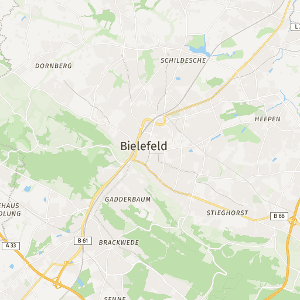
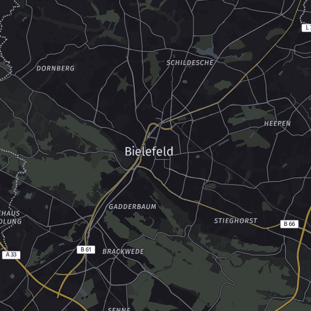
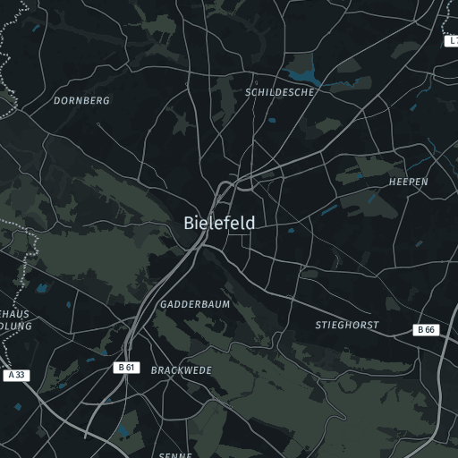
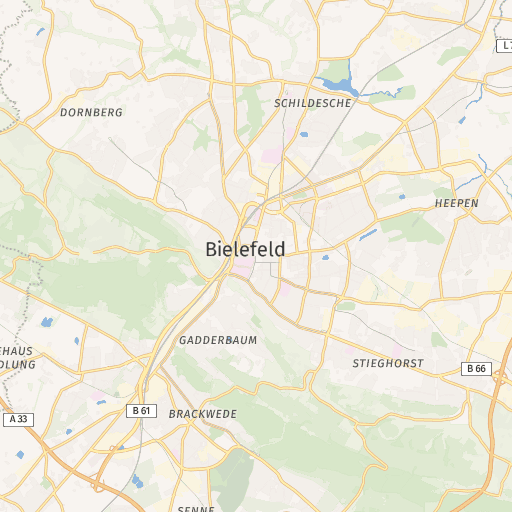
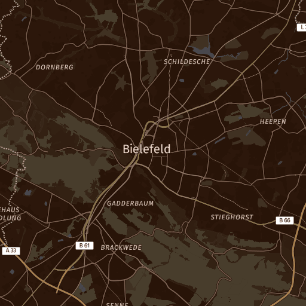
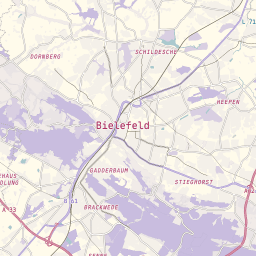
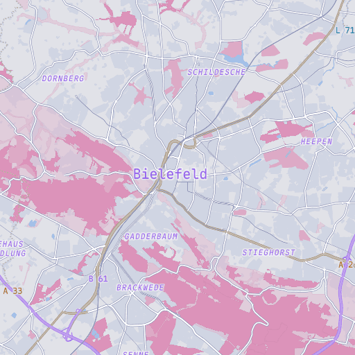
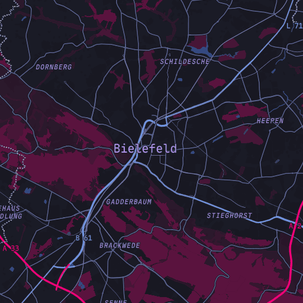

# Eigene Styles für Tiles mit Leaflet JS

> Ich mag Map Tiles, ich mag Styles, ich mag Webseiten. 
> Eigene Maptiles mit Leaflet auf der Webseite einbinden. 
> Tiles für den gewünschten Bereich om gewünschten Stil erstellen,
> auf der Webseite integrieren. Fertig. 
> Ohne eigenen Abschnitt im Datenschutz. 

Statische Kartenkacheln (PNG mit 24-Farben-Palette, wahlweise WebP) für Leaflet, nur für einen kleinen Bereich um einen Marker, selbst gehostet. Die Website braucht damit keine Anfragen an Kartendienste; auch Leaflet liegt lokal.

## Vorschau

Alle Stile in ihrer Vorschau-Schrift (Standard: Fira Sans, Nerd: Maple Mono), Bielefeld auf Zoom 12. Erzeugt mit `./make-tiles.py --readme-previews` (je Stil ein 512×512-Bild ohne Marker nach `docs/previews/`).

| | Hell | Dunkel |
|---|---|---|
| **Clear**<br><sub>Standard</sub> | <a href="docs/previews/clear.png"></a><br>Clear | <a href="docs/previews/clear-dark.png"></a><br>Clear Dark |
| **Cupertino**<br><sub>Standard</sub> | <a href="docs/previews/cupertino.png"></a><br>Cupertino | <a href="docs/previews/cupertino-dark.png"></a><br>Cupertino Dark |
| **North**<br><sub>Standard</sub> | <a href="docs/previews/north.png"></a><br>North | <a href="docs/previews/north-dark.png"></a><br>North Dark |
| **OSM**<br><sub>Standard</sub> | <a href="docs/previews/osm-light.png"></a><br>OSM light | <a href="docs/previews/osm-dark.png"></a><br>OSM dark |
| **Wiki**<br><sub>Standard</sub> | <a href="docs/previews/wiki.png"></a><br>Wiki | <a href="docs/previews/wiki-dark.png"></a><br>Wiki Dark |
| **Catppuccin**<br><sub>Nerd</sub> | <a href="docs/previews/catppuccin-latte.png"></a><br>Catppuccin Latte | <a href="docs/previews/catppuccin-mocha.png"></a><br>Catppuccin Mocha |
| **Dracula**<br><sub>Nerd</sub> | <a href="docs/previews/dracula-light.png"></a><br>Alucard | <a href="docs/previews/dracula.png"></a><br>Dracula |
| **Nightfox**<br><sub>Nerd</sub> | <a href="docs/previews/dayfox.png"></a><br>Dayfox | <a href="docs/previews/nightfox.png"></a><br>Nightfox |
| **Solarized**<br><sub>Nerd</sub> | <a href="docs/previews/solarized-light.png"></a><br>Solarized Light | <a href="docs/previews/solarized-dark.png"></a><br>Solarized Dark |
| **Tokyo Night**<br><sub>Nerd</sub> | <a href="docs/previews/tokyonight-day.png"></a><br>Tokyo Night Day | <a href="docs/previews/tokyonight-night.png"></a><br>Tokyo Night |

## Einrichtung

```sh
pip install -r requirements.txt     # fontTools
cargo install build_pbf_glyphs      # Rust-Programm, wandelt Schriften in Karten-Glyphen um
```

Außerdem nötig: podman und pngquant (`sudo dnf install pngquant`). Beim ersten Lauf lädt das Skript die OSM-Daten der Region und die Ersatzschrift Noto Sans und erzeugt die Glyphen. Das dauert einmalig einige Minuten.

## Karte für eine Website

```sh
./make-tiles.py --lat 52.0211 --lon 8.5347 --style styles/clear.toml --font "Public Sans" --retina --out out/kunde-xy
```

| Option | Bedeutung | Standard |
|---|---|---|
| `--lat`, `--lon` | Position des Markers | Bielefeld-Innenstadt |
| `--style` | Stil-Datei aus `styles/` | `styles/clear.toml` |
| `--font` | Schrift, z. B. `"Inter"`, `"JetBrains Mono"` | `font` im Stil |
| `--radius` | Bereich in km um den Marker | 5 |
| `--zoom` | Zoomstufen | `10-18` |
| `--detail-from`, `--detail-radius` | ab dieser Stufe nur dieser Bereich in km | 17, 1 |
| `--viewport` | größte Kartengröße in px, damit niedrige Zoomstufen sie füllen | `2560x1440` |
| `--retina` | zusätzlich @2x-Kacheln für hochauflösende Bildschirme | aus |
| `--format` | `png` (Palette über pngquant) oder `webp` | `png` |
| `--colors` | Farben je PNG-Kachel | 24 |
| `--area` | Geofabrik-Region, muss den Bereich enthalten (https://download.geofabrik.de) | `detmold-regbez` |
| `--label` | Text im Marker (Sprechblase bzw. Terminal `~/<label>`) | `hier` |
| `--out` | Zielordner | `out/<stilname>` |

Nach Änderungen an Stilen die README-Bilder neu erzeugen: `./make-tiles.py --readme-previews` (gut 30 Sekunden).

Nach Änderungen an `template.html`, am Marker oder am Label reicht `./make-tiles.py --reindex [--label …]`: Das schreibt die `index.html` aller Varianten neu, ohne Kacheln zu rendern.

Das Ergebnis in `out/kunde-xy/` (`tiles/`, `leaflet/`, `index.html`) einfach neben die Website hochladen.

## Varianten vergleichen

```sh
./make-tiles.py --all --zoom 16-16 --radius 1.5 --retina             # jeder Stil in seiner Vorschau-Schrift -> out/<stil>-<schrift>
./make-tiles.py --all --all-fonts --missing ...                     # volle Matrix: jeder Stil × alle Schriften seiner Gruppen
./make-tiles.py --all --style styles/wiki.toml ...                  # nur ein Stil
./make-tiles.py --all --font "Inter" ...                            # alle Stile in einer bestimmten Schrift
```

Für die Vorschau nutzt jeder Stil seine `preview_font` (Standard-Stile Fira Sans, Nerd-Stile Maple Mono); 20 Varianten dauern so gut 2 Minuten. `--missing` überspringt schon gerenderte Varianten.

- `out/streifen.html`: eine durchgehende Karte, senkrecht geteilt in einen Streifen pro Stil, alle in derselben Schrift.
- `out/compare.html`: vier Varianten im 2×2-Raster mit synchronem Ausschnitt, jedes Fenster mit eigener Auswahl.

Beide Seiten haben die Schalter **Standard | Nerd** und **Hell | Dunkel**. Stile derselben Familie sind Gegenstücke: Beim Umschalten wird aus Clear „Clear Dark“, aus Catppuccin Latte „Mocha“. Hat eine Familie einen Modus nicht, bleibt ihr Platz leer und ist beschriftet.

## Öffentliche Vorschau (GitHub Pages)

```sh
./make-tiles.py --site [--missing]     # Einstellungen aus site.toml -> site/
```

`site.toml` legt Ort (Berlin, Brandenburger Tor), Label, Zoom (16), Bereich (3,6 km, damit sich der linke Streifen bei 1920 px Fensterbreite durch alle Stile bis nach rechts schieben lässt), Retina (aus, sonst über dem 1-GB-Limit von Pages) und die Schriften je Gruppe fest (Standard: Fira Sans und Public Sans; Nerd: JetBrains Mono und Maple Mono). Ergebnis ist eine statische Seite in `site/` (`index.html` = Streifen-Ansicht) für GitHub Pages; sie wird als eigener Branch `gh-pages` ohne Historie veröffentlicht, nicht in `main`.

Die Streifen-Seite nutzt Tailwind CSS, lokal gebaut (kein CDN): `npm install && npm run css` erzeugt `vendor/streifen.css` aus `src/streifen.css`. Im Querformat sind die Streifen senkrecht, im Hochformat (Handy) waagerecht. Der Dialog „Über“ nennt alle Quellen und Lizenzen.

## Stile

Jeder Stil ist eine kurze Textdatei in `styles/`. Das Skript baut daraus zusammen mit der Grundlage `style/base.json` (OSM Bright) den fertigen Stil.

```toml
title = "North"              # Fenstertitel, die Schrift wird angehängt
category = "standard"        # standard | nerd   (Gruppe in der Vorschau)
mode = "light"               # light | dark
family = "North"             # gleiche Familie = Gegenstück beim Hell/Dunkel-Umschalten
order = 50                   # Reihenfolge in der Streifen-Ansicht (höher = weiter rechts), dann alphabetisch
font = "Overpass"            # Standardschrift
preview_font = "Fira Sans"   # Schrift für die Vorschau (--all)
fonts = ["sans", "serif"]    # Schriftgruppen für --all-fonts (Standard); Nerd-Stile zusätzlich "mono"
text_scale = 1.15            # Faktor für alle Beschriftungen
language = "de"              # Beschriftungssprache (name:de, sonst Originalname); Standard de
attribution = "Stil inspiriert von …"
hide = ["poi_r20"]           # Ebenen ausblenden (poi_r1 = wichtigste Orte, poi_r20 = unwichtigste)

[paint."*-motorway*"]        # Ebenen per Namensmuster, später stehende gewinnen
line-color = "#e892a2"
```

Die Ebenennamen stehen in `style/base.json`. Pro Ebene werden nur passende Eigenschaften gesetzt (`fill-*` auf Flächen, `line-*` auf Linien, `text-*`/`icon-*` auf Beschriftungen), daher sind breite Muster wie `water*` unbedenklich.

| Stil | Gruppe | Vorbild |
|---|---|---|
| **Clear** / Clear Dark | Standard | eigener Stil: kühl und reduziert, Farbe nur für Hauptstraßen (Standard) |
| **Cupertino** / Dark | Standard | angelehnt an den Gesamteindruck von Apple Maps (eigene Farbwahl) |
| **North** / Dark | Standard | Farben nach der Palette von Hydda (BSD-3) |
| **OSM light** / OSM dark | Standard | OSM-Standardkarte (openstreetmap-carto, CC0), aufgehellt und aufgeräumt |
| **Wiki** / Dark | Standard | Wikimedia Maps (github.com/wikimedia/osm-bright.tm2; Design CC BY 3.0, Namensnennung im Stil) |
| **Dayfox** / **Nightfox** | Nerd | Editor-Theme Nightfox (MIT) |
| **Catppuccin Latte** / **Mocha** | Nerd | Catppuccin (MIT) |
| **Alucard** / **Dracula** | Nerd | Dracula, helle Variante nach der offiziellen Alucard-Palette (MIT) |
| **Solarized Light** / **Dark** | Nerd | Solarized (MIT) |
| **Tokyo Night Day** / **Night** | Nerd | tokyonight.nvim (Apache-2.0) |
| **Cyberpunk Day** / **Neon Cyberpunk** | Nerd | maptoposter „neon_cyberpunk“ (MIT); helle Variante eigener Entwurf |

Die Stile sind eigene Umsetzungen: Von den Vorbildern sind nur Farbwerte übernommen, keine Stildateien. Jeder Nachbau nennt sein Vorbild in `attribution`; bei Wiki verlangt die Lizenz das.

Die Standard-Stile haben einen **Sprechblasen-Marker** (angelehnt an das Heroicons-Icon „chat-bubble-bottom-center“): das Label in einer abgerundeten Blase, deren Spitze unten mittig auf die Position zeigt. Bei hellen Stilen weiß, bei dunklen im Grundton, Rahmen jeweils in der Akzentfarbe des Stils (Abschnitt `[marker]`, `type = "bubble"`).

Die Nerd-Stile haben statt des Leaflet-Markers einen **Terminal-Marker**: ein Kästchen `~/<label>` mit Block-Cursor (nicht blinkend) in den Akzentfarben, darunter Stiel und Punkt auf der Position (Abschnitt `[marker]` in der Stil-Datei: `type = "terminal"`, `color`, `color2`, `bg`, `fg`). Der Text nutzt die Monoschrift des Betrachters (`ui-monospace`).

Grünflächen (Parks, Wiesen, Wald) erscheinen in den Nerd-Stilen in der Signaturfarbe des Themes, mit dem Grund gemischt: Tokyo Night Neon-Pink, Dracula/Alucard Lila, Catppuccin Peach, Nightfox/Dayfox Cyan, Solarized Gold (bei Solarized Dark in OKLCH bestimmt, weil die Mischung mit dem blaugrünen Grund sonst Grün ergäbe).

In den Nerd-Stilen erscheinen Straßennummern (A, B, L, K) ohne weißes Schild, dafür in den Akzentfarben des Themes, je nach Straßenart (Block „Akzent-Beschriftung“ am Ende der Datei).

Die dunklen Standard-Stile sind nicht invertiert (dann würden weiße Straßen dunkler als der Grund), sondern über Kartenrollen abgeleitet: Aus dem Farbton des hellen Grunds entsteht eine dunkle Graustufenleiter mit demselben Charakter (Clear kühl, Wiki warm); Wasser, Grün und Straßenfarben behalten Farbton und Sättigung und werden nur in der Helligkeit angepasst (OKLCH). Die Editor-Themes ordnen ihre Paletten denselben Rollen zu (Grund, Gebäude, Wasser, Grün, drei Straßenstufen, Schrift). Alle Dateien lassen sich von Hand nachjustieren.

## Schriften

Im Git liegen nur die Schriftquellen samt Lizenz (`fonts-src/<schrift>/`). Die Glyphen erzeugt `make-tiles.py` beim ersten Lauf nach `style/fonts/`. Welche Schnitte aus welcher Datei entstehen, steht in `style/fonts.toml`:

```toml
[Literata]
group   = "serif"  # sans | serif | mono
Regular = { file = "literata/Literata-VF.ttf", wght = 400, opsz = 12 }
Bold    = { file = "literata/Literata-VF.ttf", wght = 700, opsz = 12 }
Italic  = { file = "literata/Literata-Italic-VF.ttf", wght = 400, opsz = 12 }
scale   = 1.05     # optional: Größenfaktor
streets = "450"    # optional: eigener Schnitt für Straßennamen (muss oben als Schnitt stehen)
```

Ohne Achsenwerte wird die Datei unverändert übernommen, mit Achsenwerten wird aus der variablen Schrift ein fester Schnitt erzeugt. Neue Schrift: Dateien nach `fonts-src/<schrift>/` legen und eine Tabelle in `fonts.toml` ergänzen. Nach einer Änderung an einem bestehenden Schnitt dessen Ordner in `style/fonts/` löschen, damit er neu erzeugt wird.

| Schrift | Gruppe | Lizenz |
|---|---|---|
| Fira Sans, Inter, Overpass, Public Sans | sans | OFL |
| Literata | serif | OFL |
| TeX Gyre Schola | serif | GUST Font License |
| Fira Code, JetBrains Mono, Maple Mono, Victor Mono | mono (bei `--all-fonts` nur für Nerd-Stile) | OFL |

Noto Sans ist keine eigene Variante, sondern nur Ersatz für Zeichen, die einer Schrift fehlen (z. B. Kyrillisch).

Mit `--font` lässt sich jede Schrift mit jedem Stil kombinieren, auch eine Monoschrift mit einem Standard-Stil. Die Gruppen und `preview_font` legen nur fest, was `--all` bzw. `--all-fonts` automatisch rendert.

## Bildformat

Gemessen an 81 Kacheln (Zoom 16, Retina, Stil Clear): PNG mit 24-Farben-Palette über pngquant ist so genau wie WebP, aber etwa 8 % kleiner.

| Format | Größe | Abweichung vom Original |
|---|---|---|
| WebP | 3,91 MB | 0,91 % |
| PNG, pngquant 32 Farben | 3,94 MB | 0,74 % |
| **PNG, pngquant 24 Farben** (Standard) | **3,58 MB** | 0,90 % |
| PNG, pngquant 16 Farben | 3,20 MB | 1,03 % |

Ohne Dithering (`--nofs`), sonst werden die Dateien größer und die Flächen unruhig.

## Ablauf

1. **Planetiler** (Podman) baut aus dem Geofabrik-Extrakt einmalig `data/<area>.mbtiles` (OpenMapTiles-Schema). Zum Aktualisieren die Datei löschen.
2. **tileserver-gl** (Podman) rendert den Stil; das Skript fragt nur die nötigen Kacheln ab, vier gleichzeitig, und reduziert sie mit pngquant auf eine Farbpalette.
3. Der Container wird danach gestoppt. Das Ergebnis ist rein statisch.

Namensnennung auf der Karte: © OpenStreetMap-Mitwirkende (ODbL), © OpenMapTiles, dazu das `attribution` des Stils.

## Lizenz

Eigener Code und eigene Stile: MIT (siehe `LICENSE`). Schriften, Leaflet, OSM Bright und das Wiki-Design stehen unter ihren eigenen Lizenzen, Details in `LICENSE`.
